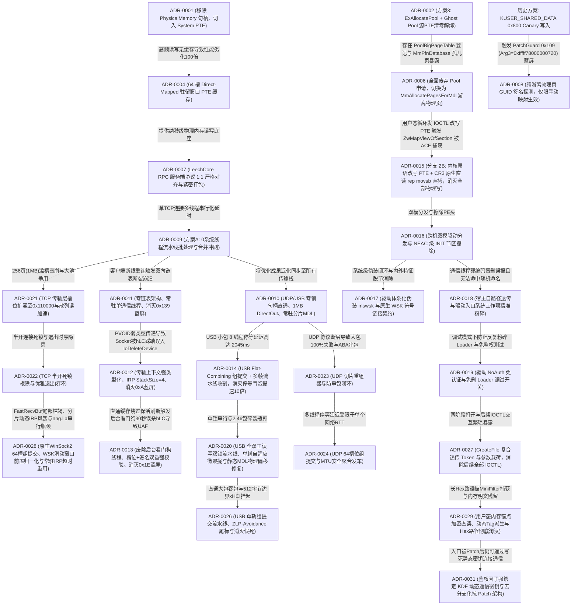

# CheatDrv 架构决策记录索引 (Architecture Decision Records)

本文档是 `CheatDrv` 项目所有关键架构决策、通信协议规范、系统级负向知识与避坑铁律的全局总索引。
**【AI 助手与研发团队铁律】**：在进行任何内核方案设计、协议重构、以及排查内核崩溃（BSOD/BugCheck）之前，**必须首先查阅本索引表与对应 ADR 正文**，严禁引入已被废弃的历史方案，严禁违反已知约束。

---

## 一、 架构决策速查总表

| ADR 编号 | 决策标题 | 核心领域 | 状态 | 核心技术要点 | 关键避坑与负向知识 |
| :--- | :--- | :--- | :--- | :--- | :--- |
| [**ADR-0001**](0001-iat-clean-and-hal-removal.md) | 驱动 IAT 导入表极致净化与 HAL 依赖彻底剥离 | 内核安全 / 静态免杀 | **已采纳** | 剥离 `HAL.dll`（CPU 自旋替代 `KeStallExecutionProcessor`）；内存分配与 IRP 全量动态化重定向；CR8 读取 IRQL | 严禁在驱动源码全局 `#define` 系统导出（如 `ObfDereferenceObject`），防止污染 WDK 头文件；IAT 仅保留 `__C_specific_handler` |
| [**ADR-0002**](0002-pte-remap-stealth-and-ace-mitigation.md) | PTE Remap 驱动高隐匿性架构改造与反作弊(ACE)规避规范 | 内存挂接 / 隐蔽注入 | **部分被替代** | JIT 动态翻转 `NX` 标志（微秒级执行窗口）；本地单核 TLB 刷新；纯叶子平栈中继；`PsInvertedFunctionTable` 启发式接管 | 严禁改 `CR0.WP` 强写（触碰 HVCI）；严禁侵入 `.rsrc` 节；严禁寄生于 `tcpip.sys`；*(注：第 6 条 Ghost Pool 解绑方案已被 ADR-0006 替代)* |
| [**ADR-0003**](0003-wechat-memory-parser-precision-model.md) | 微信 64 位内存数据解析模型重构与结构对齐 | 应用层逆向 / 内存解析 | **已采纳** | 64 位 `std::string` 手机号锚点对齐模型；群聊 `@chatroom` 强类型校验；589 联系人全量双流聚合；高清头像 URL 后向提取 | `std::string` 容量 > 15 为堆指针模式；MSVC CRT `fopen_s` 严禁混用 `"ccs=UTF-8"` 与字节流 `fprintf`（会引发 `0xC0000417` 闪退），需用 `"wb"` + 手动 BOM |
| [**ADR-0004**](0004-pte-cache-and-cr3-hierarchical-caching.md) | 轻量级 System PTE 驻留窗口缓存与 CR3 页表分级缓存架构 | 内核内存读写 / 性能优化 | **已采纳** | 1024 槽黄金平衡 System PTE 驻留窗口 + 斐波那契散列；Sequence Lock 读读无锁直读；阶梯式退避消灭 50ms 争用；RPC 原位直读零拷贝消除池锁争用 | 读写属性严格分离（读操作强制置位最高位 NX，RW=0，写操作 RW=1）；驱动清理时必须原子复原 1024 槽原始 PTE 并释放映射空间；严禁在快/慢路径高频打印 DBG |
| [**ADR-0005**](0005-transport-layer-performance-and-reliability-overhaul.md) | 传输层通信架构重构与性能可靠性加固 (TCP / UDP / USB) | 跨环/跨机网络通信 | **已采纳** | TCP 常驻 IRP 循环重用 (`IoReuseIrp`) 与滑动窗口游标；UDP 1400 字节 MTU 友好型分片重组；USB 流水线非阻塞轮询 | 严禁对常驻 IRP 重入调用；重用必须重置栈指针并重新挂接完成例程；线程退出前必须确保 IRP 处于非挂起态 |
| [**ADR-0006**](0006-headless-mdl-pages-and-pool-removal.md) | 全面废弃 ExAllocatePool 机制与纯游离物理页(MDL)架构决策 | 内存分配 / 反作弊对抗 | **已采纳** | 彻底废除 `ExAllocatePoolWithTag`；引入 `MmAllocatePagesForMdl` 纯游离物理页；宿主原生常驻物理页原位复用；`ScopedThreadAffinity` 绑核 | 严禁使用大池内存（`PoolBigPageTable` 必有记录）；严禁强行清零源 PTE 制造 `MmPfnDatabase` 孤儿页；严禁物理写 `_MMPFN` 结构（会触发 PatchGuard `0x109` 蓝屏） |
| [**ADR-0007**](0007-leechcore-rpc-protocol-1to1-alignment.md) | LeechCore RPC 服务端协议一比一对齐与防错位规范 | 跨环/跨机网络通信 / 协议规范 | **已采纳** | `WriteScatter` 响应严格采用 `cMEMs * sizeof(BOOL)` 布尔数组；`ReadScatter` 实施两阶段紧密打包仅打包成功页（杜绝 Offset Shift）；集成 4 槽 XPRESS 并发压缩与自动解压管道；继承 64 槽 System PTE 读写底座 | 严禁在 WriteScatter 返回全量 `MEM_SCATTER` 结构体；严禁在 ReadScatter 响应中保留失败页空洞数据；严禁硬编码工作区体积（必须动态查询）；严禁解包超过 64MB 防止溢出 |
| [**ADR-0009**](0009-wsk-nng-async-worker-pool-and-multiplexing.md) | WSK NNG 流水线批处理与全双工异步双缓冲发送架构 (Pipeline Batching & Double-Buffered Async Send) | 跨环/跨机网络通信 / 并发优化 | **已采纳** | 彻底废除多工作线程池；纯单线程流水线批处理（0 额外系统线程，100% 免疫反作弊）；4 槽位 1MB 全双工深度环形流水线；100~240 页大跨页 100% DirectOut 原位直写；分发前智能预估与前置异步冲刷（消灭 100% 大池分配与二次 memcpy）；`WSK_FLAG_NODELAY` 即时出网 | 严禁在热路径频繁调用 `ExAllocatePoolWithTag` 导致内核池自旋锁争用；严禁在热路径使用 KeWaitForSingleObject 微秒超时轮询（受限于系统时钟节拍导致 2ms 延迟雪崩）；严禁异步 IRP 完成例程使用局部栈变量上下文（会引发 BugCheck `0xD1`）；WSK 关闭必须原子置空指针防范二次 Close |
| [**ADR-0010**](0010-transport-layer-unified-optimization-udp-usb.md) | 全传输层高性能优化同步与统一直通架构 (UDP & USB Transport Layer Optimization) | 跨环/跨机网络通信 / 传输层统一 | **已采纳** | 统一抽象 `MK_TRANSPORT_CONTEXT` 通用直通上下文；UDP/USB 零锁句柄直通消灭互斥体争用；UDP 扩容至 1MB 支持 100% DirectOut 原位直写；UDP 常驻 `pSliceBuf` + 预构建 MDL 彻底消灭分片热路径动态分配；USB 全双工双缓冲重叠 I/O 流水线 (`UsbHub_BulkWriteAsync` + `UsbHub_BulkReadFast`，常驻 IRP / MDL 0 动态申请，消灭 250 微秒单管停等气泡) | 严禁在传输服务端停止时遗留旧句柄缓存（必须显式置空）；UDP 切片必须遵循 `MK_UDP_SLICE_HDR` 契约；严禁引入额外内核线程 |
| [**ADR-0011**](0011-zero-list-permanent-thread-and-corrupt-entry-bsod.md) | 零链表架构、常驻单线程模型与彻底根除 BugCheck 0x139 (FAST_FAIL_CORRUPT_LIST_ENTRY) | 网络通信架构 / 系统崩溃根治 | **已采纳** | 彻底废除 `LIST_ENTRY` 双向链表与多客户端并发模型；驱动全生命周期仅创建单个常驻系统线程（`WskServerThread`）；单例 5.2MB 上下文一次性预分配与持久化复用；串行 Accept 阻塞唤醒 | 严禁在网络断线重连等动态生命周期中使用裸 `LIST_ENTRY`（内核 `int 29h` 完整性校验极易引发 `0x139` 蓝屏）；严禁在客户端接入时动态调用 `PsCreateSystemThread` 触发反作弊深度审计；大尺寸缓冲严禁高频申请释放 |
| [**ADR-0012**](0012-wsk-transport-context-corruption-and-stack-underflow-bsod-0xa.md) | 传输层通用直通上下文强类型化与彻底根除 BugCheck 0xA (IRQL_NOT_LESS_OR_EQUAL) | 跨环网络通信 / 系统崩溃根治 / 类型安全防御 | **已采纳** | `PMK_TRANSPORT_CONTEXT` 强类型化废除 `PVOID` 传递；`MK_WSK_CLIENT` 嵌入 `TransportCtx` 彻底隔离 `Socket` 偏移；IRP `StackSize` 统一由 1 升至 4 防止下层过滤驱动栈下溢；内核规范高半区指针校验 | 严禁使用弱类型 `PVOID` 传递包含可写成员的跨层上下文（导致结构体偏移错位踩踏对象首字段）；IRP 栈大小严禁写死 1；套接字派遣前必须强校验规范指针地址 |
| [**ADR-0013**](0013-rpc-handle-uaf-and-inactivity-watcher-removal-bsod-0x1e.md) | 废除 RPC 后台超时看门狗线程、句柄槽位双向强校验与彻底根除 BugCheck 0x1E (Use-After-Free) | 跨环网络通信 / 生命周期管理 / 系统崩溃根治 | **已采纳** | 彻底废除 `LeechRPC_LcHandle_InactivityWatcherThread` 后台线程；`Cached_hLC` 绑定 `ClientList` 槽位与 `LC_CONTEXT_VERSION` 签名双重无锁校验；`SharedUserData` 零开销刷新时间戳；`LcClose` 释放前清零签名与函数表 | 严禁快路径缓存绕过保活时间戳更新导致后台线程 30 秒误杀活跃句柄（引发 `LcReadScatter` UAF `0x1E` 蓝屏）；严禁未校验 `LC_CONTEXT_VERSION` 与规范地址直接间接调用 `pfnReadScatter` |
| [**ADR-0014**](0014-usb-transport-group-commit-and-pipeline-batching.md) | USB 传输层 Flat-Combining 组提交与流水线批处理合并回包架构 (Group Commit & Pipeline Batching) | 跨机/跨环 USB 通信 / 并发优化 | **已采纳** | 客户端 Flat-Combining 组提交（64 静态槽位 + Leader 批量打包 + 1 次 WinUsb 发送/接收 + Nonce 映射唤醒）；驱动端多帧流水线滑动收割与合并回包；原样回传 `qwReqNonce`；大包直通旁路保证 157 MB/s 零退化；IRP StackSize=4 纵深防御 | 严禁在组提交中使用动态内存分配或链表；严禁在持有 `QueueLock` 时执行物理 I/O；大包必须走独占硬件直通通道；驱动必须原样回传 Nonce |
| [**ADR-0015**](0015-branch-2b-kernel-pte-remap-and-direct-copy-pipeline.md) | 宿主驱动原位 PTE 缝合、CR3 进程直读特权与彻底根除 ZwMapViewOfSection 反作弊特征 (Branch 2B Architecture) | 内核隐蔽注入 / 反作弊(ACE)规避 / 内存挂接架构 | **已采纳** | 借用 Loader 线程当前 CR3 直读特权；3 微秒 `rep movsb` 硬件级搬移镜像；内核原语 `MmAllocatePagesForMdl` + `MmMapIoSpace` 闭环重映射 PTE；单次未知 IOCTL 触发；用户态物理写次数与 `ZwMapViewOfSection` 彻底归零 | 严禁在用户态频繁调用工具驱动物理写 IOCTL（触发反作弊 `\Device\PhysicalMemory` 句柄监控）；Shellcode 严格限制在 333 字节内防止溢出 463 字节 Code Cave 红线；保持跳回宿主现场恢复 `rdi` |
| [**ADR-0016**](0016-dual-mode-driver-dispatch-and-neac-init-wiping.md) | 跨机双模驱动分发、自适应加载决策与 NEAC 级 INIT 节区擦除生命周期闭环 | 跨机通信 / 驱动加载与反转储 / 生命周期治理 | **已采纳** | 云端 `core_driver` 与 `driver_mode` (1正常/2映射) 纳管分发；B 机跨机动态参数与载荷投递；`host_loader` 正常模式绝不释放 `Machenike.sys` 白驱动；驱动尾部 NEAC Discardable INIT 节区与 PE 头部物理清零；就绪后 `host_loader` 延时 500ms 自动退出消除进程审计 | 模式 1 严禁落地白驱动；`host_loader` 发完 ACK 必须等待 500ms 防止 TCP 栈发送 RST 报文导致 B 机 10054 错误；INIT 擦除必须经 `MmIsAddressValid` 校验 |
| [**ADR-0017**](0017-system-wsk-driver-and-device-stealth-disguise.md) | 驱动体系化伪装、原生 WSK 符号链接契约与特征脱节消除 | 反作弊对抗 / 符号伪装 / 架构精简 | **已采纳** | 驱动文件重构为原生系统语义 `mswsk.sys`；SCM 服务名为 `mswsk`；内核设备对象 `\Device\MsNetEndpoint` 与符号链接 `\DosDevices\MsNetEndpoint` 统一切换消除 0xC0000035 冲突；消除旧白驱动残留变量与两次分支重复代码 | 跨端打开路径必须严格对齐 `\\.\MsNetEndpoint`；驱动卸载必须成对销毁设备与符号；严禁使用第三方特征前缀驱动名 |
| [**ADR-0018**](0018-targeted-host-loader-deletion-via-system-worker-item.md) | 废除常驻线程硬编码盲删、宿主加载器自路径透传与驱动入口系统工作项精准粉碎 | 反作弊对抗 / 痕迹清理 / 跨环契约 | **已采纳** | 废除 `WskServerThread` 启动时硬编码候选路径盲删；扩展 `DRV_BOOT_CONFIG_EX` 透传真实路径；宿主加载器通过 `GetModuleFileNameW` 自提取并下发；驱动入口挂靠系统工作线程（System Worker Thread）记录调用方 PID 并循环探测进程生命周期（200ms 步长，超时 10 秒退出，退出确认后粉碎文件） | 严禁破坏 `ShellcodeParams` 120 字节对齐（必须通过派生结构体扩展）；文件打开必须强制 `OBJ_KERNEL_HANDLE`；必须循环轮询等待宿主完全退出释放执行句柄，超时必须主动安全退出线程防死锁 |
| [**ADR-0019**](0019-no-auth-debug-mode-and-loader-preservation.md) | 驱动 NoAuth 免认证与免删 Loader 调试开关规范 | 跨环通信契约 / 调试模式治理 / 痕迹清理控制 | **已采纳** | 引入 `NO_AUTH` / `ENABLE_NO_AUTH` 宏开关；跳过 `MachenikeDispatchCreate` 文件名 Token 计算与 `IOCTL_MK_START_TRANSPORT` 魔数拒绝；驱动入口跳过系统工作项删除 Loader 保留二进制现场 | 生产发布环境严禁使能；签名回传 `DriverSignature` 逻辑保持透明计算，防止破坏应用层既有校验链 |
| [**ADR-0020**](0020-usb-transport-full-duplex-pipeline-and-micro-coalescing.md) | USB 传输层全双工读写双锁流水线、单趟自适应微聚拢与静态 MDL 物理偏移修复 | 跨机/跨环 USB 通信 / 并发优化 / 系统稳定性 | **已采纳** | 驱动端修复 `cbRemain > 0` 静态 MDL 覆写与双缓冲 **Wait-Before-Write** 在飞 DMA 踩踏；发送槽扩容至 `0x110000`；客户端单趟交接、15µs 微聚拢、SendLock/RecvLock 全双工重叠；大包直通统一接入 `cbRecvRemain` 与在飞 Nonce 互助分发根除 121 超时 | 静态 MDL 严禁传入带偏移地址或置空 MDL；双缓冲严禁未 `WaitWriteSlot` 先覆写 `pbDirectOut`；严禁开启 `RAW_IO` 破坏非对齐续读 |
| [**ADR-0021**](0021-tcp-wsk-pipeline-slot-expansion-and-scatter-read-acceleration.md) | TCP 传输层槽位扩容、消灭 1MB 溢槽雪崩与散列读请求零分配加速 | 跨机/跨环 TCP 通信 / 性能优化 / 内存分配优化 | **已采纳** | 驱动端单发送槽位 `MK_WSK_SEND_SLOT_SIZE` 与压缩缓冲扩容至 `0x110000` (1MB+64KB)；256 页（整 1MB 数据）散列读 100% 命中 DirectOut 原位直写与 4 槽位全双工异步发送；客户端剥离 `READSCATTER_REQ` 画蛇添足压缩，消灭驱动端高频动态池解压；移除物理读热路径高频 DBG 打印与冗余清零 | 传输层单帧最大有效载荷计算必须包含协议头与元数据，严禁槽位尺寸刚好等于数据纯载荷（导致溢出）；只对写载荷启用压缩，严禁压缩只读地址描述符 |
| [**ADR-0022**](0022-tcp-wsk-nng-stability-and-deadlock-prevention.md) | TCP (WSK/NNG) 传输层半开死锁根除与优雅退出防挂起闭环 | 跨机/跨环 TCP 通信 / 稳定性与死锁防护 | **已采纳** | 客户端补全 `SetOption` 漏发调用；TLS 绑定当前 `sock.id` 防止断线重连失效并禁止全局 `TlsFree`；驱动端分包读取全链路启用 10 秒超时（`WskSyncReceiveTimed`）根除半开连接假死；`Cleanup` 遵循“先 Close Socket 后 Drain Pending Send”铁律，并在 `WskDrainPendingSend` 引入 5 秒超时与 `IoCancelIrp` 双重防死锁兜底；发送大包前排空异步流水线 | 退出清理严禁先 Drain 后 Close（未决 IRP 依赖对端 ACK 会导致永久死锁）；网络分包接收严禁无超时无限等待 |
| [**ADR-0023**](0023-udp-transport-slice-reassembly-and-aba-prevention.md) | UDP 传输层协议断层修复、零拷贝分片重组器与防串包闭环 | 跨机/跨环 UDP 通信 / 协议对齐 / 系统稳定性 | **已采纳** | 客户端实现 `MK_UDP_SLICE_HDR` (`'UDPS'`) 零拷贝分片重组器，彻底修复 $\ge 4\text{KB}$ 大包通信 100% 失败；驱动端响应严格回传 `qwReqNonce` 结合客户端 Nonce 断言消灭 ABA 串包；升级 `udp_discovery.c` 为 `StackSize = 4` 消除蓝屏隐患；全局持久化静态缓冲消除 128KB 局部栈开销；开启 UDP XPRESS 硬件线速压缩并将 `dwMaxChunk` 扩容至 128 页 | UDP 切片传输中客户端严禁缺失重组协议；无连接 UDP RPC 响应严禁回填随机 Nonce（必须回传请求原 Nonce） |
| [**ADR-0024**](0024-udp-flat-combining-group-commit-and-pipeline-aggregation.md) | UDP 传输层 Flat-Combining 组提交与 MTU 安全聚合发车架构 | 跨机/跨环 UDP 通信 / 并发性能优化 | **已采纳** | 客户端 64 槽位 Flat-Combining 组提交；严格受限于 1400 字节 MTU 安全聚合发车；驱动端多帧流水线连续收割与合并回传；客户端批量解包与 Nonce 精准匹配分发；`Leader Handoff` 平滑交接彻底根除末班车孤儿死锁；大包独占通道零退化 | 客户端聚合发车与服务端合并回传严格 $\le 1400$ 字节，严禁溢出导致 IP 分片丢包；必须通过 64 位 Nonce 强断言匹配对应槽位，严禁隐式顺序匹配 |
| [**ADR-0025**](0025-dispatch-create-dynamic-token-auth-and-loader-alignment.md) | 驱动端 IRP_MJ_CREATE 动态 Token 防伪接入与加载器全链路协同 | 访问控制 / 动态 Token / 跨环契约 | **已采纳** | 挂接 `MachenikeDispatchCreate` 验证时间戳 Token；增强 `UserVar` 空指针防御（回退 `g_pGlobalUserVar`）；SCM/Host 加载器全链路提供 `OpenDriverDeviceCompatible` 支持 `[-1, 0, 1]` 窗口 Token 计算与 NoAuth 裸路径平滑降级；前端移除选择模式自动盲连 | 跨环打开时必须具备时间窗口容差；生产环境严格受 `NO_AUTH 0` 约束；修改源码必须运行 `convert_bom.py` 保证 UTF-8 BOM 编码 |
| [**ADR-0026**](0026-usb-single-pipeline-and-zlp-avoidance-trailer.md) | USB 传输层单轨组提交流水线、ZLP-Avoidance 尾标与周期性假死挂起彻底根除 | 跨机/跨环 USB 通信 / 协议契约 / 稳定性根治 | **已采纳** | 废除 `fLargeReq` 双轨制，所有请求 100% 登记入 `Slots[64]`；Leader 优先收割自身槽位并实施单槽水位上限（`MAX_BATCH_EST_RSP = 0xE0000`）根除双槽满载死锁；驱动发送满 512/1024B 追加 12B 全零短包尾标 (`[0ULL][0UL]`)；接收缓冲扩容至 `2MB+64KB` 且读取长度强制按 `& ~0x3FFU` 对齐 1024B 根除 `USBD_STATUS_BABBLE_DETECTED` | 严禁绕过全局槽位独立收发；严禁无上限批量收割超出驱动单槽容量 `0x110000`；任何带残片偏移的 USB 读取长度必须向下对齐 1024B (`wMaxPacketSize`) |
| [**ADR-0027**](0027-createfile-token-payload-pipeline-and-ioctl-elimination.md) | 驱动 CreateFile 阶段 Token 与参数复合透传及 IOCTL 彻底消除规范 | 跨环通信契约 / 鉴权与极简架构 | **已采纳** | 驱动端 `DispatchCreate` 优先校验 Token 防伪，通过后解析复合路径 HexPayload 直接激活服务；Loader 默认一次性透传 Token 与参数并立即释放句柄，彻底消除 `IOCTL_MK_START_TRANSPORT` 与 `IOCTL_MK_GET_STATUS` | 严禁跳过 Token 校验短路处理 HexPayload；驱动启动服务失败必须赋回 NTSTATUS 错误状态；严禁在激活后遗留无用 IOCTL 交互 |
| [**ADR-0028**](0028-tcp-native-group-commit-and-wsk-sliding-window-fix.md) | TCP 传输层原生 WinSock2 组提交重构、WSK 滑动窗口尾部枯竭根治与常驻 IRP 超时重用 | 跨机/跨环 TCP 通信 / 并发优化 / 依赖剥离 | **已采纳** | 彻底剥离 `nng.lib`/`mbedtls`，客户端原生实现 NNG SP `REQ0/REP0` 线协议与 64 槽位 Flat-Combining 组提交全双工流水线；驱动端修复 `>=12B` 半包绕过归一化导致的 `FastRecvBuf` 尾部枯竭，并使 `WskSyncReceiveTimed` 带超时场景 100% 复用常驻 `pRecvIrp`；散列读 XPRESS 压缩阈值升至 64KB | 常驻 IRP 超时取消后必须同步等待 `Sync.pEvent` 回收所有权方可重用；滑动接收窗口尾部低于 256KB 时必须在循环首部无条件归一化 |
| [**ADR-0029**](0029-user-mode-memory-anchor-encrypted-payload.md) | 用户态内存锚点加密传输、动态 Tag 直读与 Hex 路径彻底淘汰规范 | 跨环通信契约 / 反作弊规避 / 内存加密 | **已采纳** | 用户态 `.data` 节区建立 `DRV_USER_PAYLOAD_ANCHOR` 静态锚点；动态 Token 派生 `Tag0/Tag1` 消灭静态特征码；RC4 密文传输；驱动 `MachenikeDispatchCreate` 原生 CR3 上下文节区直读解密；内核特权物理清零用户态内存实现“阅后即焚”；彻底淘汰 HexPayload 路径 | 节区扫描必须置于 `PASSIVE_LEVEL` 且由 `__try/__except` 强保护；用户态结构体必须 16 字节对齐且驻留在读写数据节；严禁保留老旧 Hex 路径代码 |
| [**ADR-0030**](0030-pure-static-class-modular-architecture-refactor.md) | 驱动全模块纯静态类封装与功能子目录架构解耦规范 | 架构重构 / 纯静态类 / 模块化解耦 | **已采纳** | 驱动按六大高内聚模块规划功能子目录（`Core/`, `Security/`, `Diagnostics/`, `Memory/`, `Transport/`, `Stealth/`）；全量抽象为纯静态类（`DriverCore`, `DrvSecurity`, `Utils`, `ExceptionReporter`, `LeechCoreEngine`, `RpcDispatcher`, `TransportManager`, `StealthReloc`, `WfpBypass`, `NetMonitor`）；0 虚函数（无 vtable 反作弊特征）、0 动态实例、0 单行垫片；`Main.cpp` 极简收敛直调；彻底清除历史死代码 | 严禁声明虚函数产生 vtable 靶点；类定义必须置于 `#ifdef __cplusplus` 防止纯 C 模块报错；跨目录头文件统一由 MSBuild 包含目录注入；源码必须维持 UTF-8 BOM 编码 |
| [**ADR-0031**](0031-kdf-dynamic-session-crypt-and-anti-patch.md) | 鉴权因子强绑定 KDF 动态通信密钥与去分支化抗 Patch 架构 | 鉴权与防破解 / 跨环协议 / 加密通信 | **已采纳** | 彻底废除全工程写死静态密钥；驱动由 `SessionToken` 经 SipHash-2-4 实时推导 `SessionCryptKey`；`wsk/udp/usb` 传输全链路去分支化加解密；客户端（`leechcore`）支持 URL `k=` 解析与 API 动态下发；入口 Patch 即静默瘫痪物理读写 | 传输层密钥读取必须支持在任意 IRQL 下并发原子直读；空/无效 Token 严禁命中默认密钥，确保非法调用链路彻底错乱 |

---

## 二、 架构演进路线与替代关系

---

## 三、 系统级核心负向知识速查 (Negative Knowledge)

在驱动与加载器开发中，以下为经全量推演与踩坑总结的**绝对禁忌操作**：

1. **蓝屏 BugCheck `0x109` (CRITICAL_STRUCTURE_CORRUPTION)**：
   - 严禁试图物理修改 `nt!MmPfnDatabase` 中的 `_MMPFN` 结构体来伪造页表归属；PatchGuard 会周期性做 DPC 校验。
   - **严禁向 `KUSER_SHARED_DATA`（`0xFFFFF78000000000`）写入任何数据**：现代 Windows 10/11 的 PatchGuard 会对整页 `_KUSER_SHARED_DATA` 进行加密哈希校验；在 `0x800` 等空闲偏移写入会导致运行约 20 分钟后触发 `0x109` 蓝屏（Arg3=0xfffff78000000720），必须采用 ADR-0008 游离物理页方案。
2. **蓝屏 BugCheck `0x1E` / `0x4E` (PFN_LIST_CORRUPT) / `0xBE` (ATTEMPTED_WRITE_TO_READONLY_MEMORY)**：
   - 现代 Windows 10/11 开启 HVCI 场景下，严禁通过修改 `CR0.WP` 强写只读内存；
   - 写入内核页前必须通过物理页表设置 `PTE.RW = 1`，并在写入后及时还原。
3. **蓝屏 BugCheck `0xFC` (ATTEMPTED_EXECUTE_OF_NOEXECUTE_MEMORY)**：
   - 代码执行落点所在的 PTE 必须物理清除最高位 `PTE.NX`（置 0）；
   - 挂接探针前必须使用 `ScopedThreadAffinity` 锁定单核，防止核间调度导致多核 TLB 视图不同步。
4. **蓝屏 BugCheck `0xD1` (DRIVER_IRQL_NOT_LESS_OR_EQUAL)**：
   - 严禁将函数的局部栈变量用作异步 IRP 完成例程的上下文参数（`IoSetCompletionRoutine` 中的 `Context`）；
5. **蓝屏 BugCheck `0x50` (PAGE_FAULT_IN_NONPAGED_AREA - Write to Read-Only Page)**：
   - **严禁在内核 Shellcode 中依赖硬编码栈偏移（如 `mov rcx, [rsp + 0xC0]`）企图自完成 IRP (Self-Complete IRP)**：
     * Windows x64 ABI 中，IRP 指针在寄存器 `rdx` 中传递；宿主白驱动或不同的编译器优化下，绝不会保证将 `rdx` 稳定溢出存入栈帧特定偏移槽位；
     * 脆弱的栈偏移常会读取到调用方（如 `nt!IofCallDriver+0x55`）留在栈上的返回地址。此时若盲写 `mov dword ptr [rcx+30h], 0`，等同于尝试修改 `ntoskrnl.exe` 只读代码段，立即引发硬件 MMU 保护违例（BugCheck `0x50`，Arg2=`0x03`）；
     * **正确防范与规避准则**：探针 Shellcode（`scAllocMdlProbe`）与加载 Shellcode（`scDirectExec`）必须严格遵循**跳回宿主现场（`hookReturnVA = site.kernVA + 5`）**，恢复所有寄存器并将执行结果状态码放入 `ebx`，由宿主原有的 WHQL 认证派遣流程自然提交并完成 IRP，严禁由外部 Shellcode 强行猜测宿主私有栈帧。
6. **蓝屏 BugCheck `0x3B` (SYSTEM_SERVICE_EXCEPTION - 0xC0000005 NULL Pointer Dereference)**：
   - **宿主白驱动（如 `Machenike.sys`）default 分支漏恢复设备扩展指针 `rdi` 陷阱**：
     * 宿主派遣函数的 IRP 完成清理例程通常依赖寄存器（如 `rdi`）持有 `DeviceExtension`，并通过 `[rdi + 0x40]` 调用宿主缓存的 `IofCompleteRequest` 函数指针；
     * 宿主白驱动在常规分支跳入 cleanup 前均有 `mov rdi, [rsp + 0x38]` 重载操作，但在未支持的未知 IOCTL `switch default` 分支处往往缺少此重载，导致 `rdi = 0` 进入清理流程时触发 `mov r8, [rdi+40h]` 空指针访问违例；
     * **防御修复准则**：在 Shellcode 跳回宿主 `site.kernVA + 5` 前，必须显式替宿主执行 `mov rdi, [rsp + 0x38]`（宿主栈上备份的 `DeviceExtension`，而 `[rsp + 0x50]` 在入口处被清零），保证宿主后续间接调用 `IofCompleteRequest` 时指针有效合法。
   - **内核 Shellcode 践踏 x64 非易失性寄存器（`rbp` / `ebp`）导致外层文件锁崩溃陷阱**：
     * x64 ABI 明确规定 `rbp` 属于非易失性寄存器（Callee-saved）；Windows 内热 I/O 管理器（`nt!IopSynchronousServiceTail`）在进入驱动派遣前，使用 `rbp` 寄存器长期持有 `FileObject` 指针；
     * Shellcode 严禁随手借用 `ebp` 作为临时状态码变量；一旦清零或覆写 `ebp`，驱动返回内核后 `IopReleaseFileObjectLock(FileObject)` 将获取到 `rcx = 0`，解引用 `[rbx + 0x74]` 必然引发崩溃；
   - **内核态清理栈上伪造对象时越界清零（Stack Smashing）导致寄存器全零与 IRP 崩溃陷阱**：
     * 手动映射执行 Shellcode（`scDirectExec`）通常在局部栈帧上伪造临时 `DRIVER_OBJECT`（`0x150` 字节）；核心驱动初始化完毕后若调用 `RtlZeroMemory(pDriverObj, 0x200)`，超出 `0x150` 字节边界的清零动作会直接向高地址栈帧越界践踏 136 字节；
     * 越界清零会直接将 Shellcode 压栈保护的 7 个非易失性寄存器（`r15..r12, rdi, rsi, rbx`）以及宿主白驱动栈上局部变量（`[rsp + 0x38]` 等）全量置零。Shellcode 平栈弹出后所有寄存器归零，跳回宿主执行 `mov [r15+30h], ebx` 时立即触发 `r15 = 0` 空指针崩溃（BugCheck `0x3B`，Arg2=`Machenike+0x17fc`）；
     * **防御修复准则**：对象擦除必须严格限制在 `sizeof(DRIVER_OBJECT)`（`0x150` 字节），严禁使用超出边界的硬编码尺寸（如 `0x200`）；同时 Shellcode 栈帧必须分配充足安全冗余（`sub rsp, 0x248`）形成纵深防御。
7. **蓝屏 BugCheck `0x1E` (KMODE_EXCEPTION_NOT_HANDLED - 0xC0000005 #GP) / x64 ABI 栈对齐与 SSE `movaps` 崩溃**：
   - **内核 Shellcode 调用 `DriverEntry` 违反 x64 ABI 16 字节栈对齐要求**：
     * Windows x64 ABI 明确规定：函数在发起 `CALL` 指令前，栈指针 `%rsp` 必须满足 16 字节对齐（`RSP % 16 == 0`）。进入被调用函数的第一条指令时，由于压入了 8 字节的返回地址，`RSP` 必然为 `0x...8`（`RSP % 16 == 8`）；
     * 宿主白驱动在 Hook 点处处于函数内部计算状态，其 `rsp_host` 严格以 16 字节对齐（`% 16 == 0`）；
     * `scDirectExec` 压入 7 个寄存器（56 字节，`56 % 16 == 8`），若紧接着使用 `sub rsp, 0x240`（576 字节，`576 % 16 == 0`），则总栈消耗为 632 字节（`632 % 16 == 8`）。此时在执行 `call rax`（调用 `DriverEntry`）前 `RSP % 16 == 8`，`call` 压栈后进入 `DriverEntry` 入口时 `RSP % 16 == 0`；
     * 这导致后续执行体所有函数的局部栈偏移全部错位 8 字节。当调用系统内部涉及 SSE 指令的内核例程（如 `nt!RtlpHpSegMgrCommit`、`nt!ExAllocatePoolWithTag` 中的 `movaps xmmword ptr [rbp-31h], xmm0`）时，目标内存地址以 8 结尾未对齐 16 字节，直接触发 CPU 硬件通用保护错误 `#GP`（BugCheck `0x1E`，参数1=`0xC0000005`，参数2=`nt!RtlpHpSegMgrCommit+0x14a`）；
     * **防御修复准则**：在保留 7 个压栈寄存器（56 字节）的前提下，局部栈帧分配量必须满足 `(56 + STACK_ALLOC) % 16 == 0`，即必须将 `sub/add rsp, 0x240` 调整为 **`sub/add rsp, 0x248`**（584 字节，`56 + 584 = 640 = 0x280`，严格为 16 的倍数），保证在 `call DriverEntry` 瞬间 `RSP % 16 == 0`，进入函数后 `RSP % 16 == 8`，彻底杜绝 SSE 指令 `#GP` 异常。
8. **反作弊检出靶点 (ACE / EAC / Vanguard)**：
   - **大池表**：任何大于 4KB 的 `ExAllocatePool*` 必然登记在 `nt!PoolBigPageTable` 中，不可作为隐蔽代码载体；
   - **系统线程创建**：严禁在内核态直接调用 `PsCreateSystemThread` 创建匿名工作线程池，会触发反作弊 `PsSetCreateThreadNotifyRoutine` 深度审计 StartAddress 归属；多线程并发吞吐必须通过 ADR-0009 流水线批处理与合并冲刷解决；
   - **PE 头篡改**：严禁篡改宿主白驱动的 DOS/NT 头部与 `.pdata` 异常表；必须采用 Leaf 纯叶子平栈退出；
   - **资源节**：严禁借用 `.rsrc` 节区（白驱动资源目录被文件完整性哈希严格校验）。
9. **蓝屏 BugCheck `0x139` (KERNEL_SECURITY_CHECK_FAILURE - Arg1=0x3 FAST_FAIL_CORRUPT_LIST_ENTRY)**：
   - **双向链表在断线重连竞态下的断裂与硬件断言崩溃**：
     * Windows 8 及以上内核中，执行 `InsertTailList` 或 `RemoveEntryList` 时内核内置硬件级完整性自检 `int 29h`（`FAST_FAIL_CORRUPT_LIST_ENTRY`）；
     * 在高频断线重连或多核调度场景下，若采用多线程各自在 worker 线程退出时解绑链表，极易因并发时序产生旧节点 `Blink->Flink != ListHead` 的悬挂自环断裂，瞬间引发系统不可拦截的 `0x139` 蓝屏；
     * **防御修复准则 (Zero-List 铁律)**：在以单一控制端为主的内核通道中，坚决废除 `LIST_ENTRY`、`ClientListLock` 与多客户端管理模型；切换为**单例预分配（5.2MB 一次性预分配）与常驻单系统线程（`WskServerThread` 串行 Accept/Session）架构**，从数据结构与数学层面上物理消灭 `BugCheck 0x139` 的所有触发路径。
10. **蓝屏 BugCheck `0xA` (IRQL_NOT_LESS_OR_EQUAL - Arg1=0x18, Arg2=0x2 DISPATCH_LEVEL)**：
    - **跨层接口 PVOID 弱类型强转导致相邻结构体首字段（Socket）被覆写踩踏**：
      * 严禁在内核模块间使用 `PVOID` 传递带有内部修改特权的通用上下文指针；
      * 若调用方传递父对象（`MK_WSK_CLIENT`），而被调用方无条件强转为子上下文（`MK_TRANSPORT_CONTEXT`）并执行赋值（`pTransCtx->Cached_hLC = hLC`），会直接将首字段 `Socket` 覆写为 `hLC`（`LC_CONTEXT*`）；
      * `WskSend` 读取篡改后的 `Socket->Dispatch`，实际读到了 `LC_CONTEXT` 偏移 0 的 `UserVar`，而 `UserVar` 偏移 `+0x30` 正好是 `IoDeleteDevice`，导致网络分发误入 `IoDeleteDevice`，并在 `DISPATCH_LEVEL` 解引用非法的 `DeviceObjectExtension` 触发不可挽回的 `0xA` 蓝屏；
      * **防御修复准则**：全面推行**强类型声明（`PMK_TRANSPORT_CONTEXT`）**，废除所有 `PVOID` 泛型上下文；嵌套结构体必须使用组合或联合体严格按成员取地址传递；分配 IRP 栈位置必须升级为 `StackSize >= 4`，杜绝任何栈下溢越界。
11. **蓝屏 BugCheck `0x1E` (KMODE_EXCEPTION_NOT_HANDLED - 0xC0000005 #GP at `LcReadScatter+0x1e`, Arg4=`0xFFFFFFFFFFFFFFFF`)**：
    - **直通缓存绕过保活时间戳更新，导致后台看门狗线程 30 秒后异步误杀 `hLC` 引发释放后重用 (UAF)**：
      * 若快路径直接返回 `pTransCtx->Cached_hLC` 而不更新全局表 `ClientList[i].qwLastTickCount64`，后台 `InactivityWatcherThread` 会在会话满 30 秒时误判客户端超时并调用 `LcClose(hLC)` 释放 `LC_CONTEXT`；
      * 释放后 `pTransCtx->Cached_hLC` 仍保留原地址（悬垂指针），单页读（`cMEMs == 1`）因未解引用 `hLC` 侥幸存活，一旦遇到多页散列读（`cMEMs > 1`）调用 `LcReadScatter` 读取已被内核复用的 `[rcx+0x398]`（非规范地址如 `0x402024548d48284f`）并执行 `call rax`，立即触发硬件 `#GP` 导致 `0x1E` 蓝屏；
12. **跨 URB 残片传输时误用静态常驻 MDL 导致底层 xHCI DMA 覆写残片内存踩踏**：
    - **DMA 忽略虚拟指针偏移陷阱**：
      * Windows USB 栈（USBPORT.SYS / USBHUB3.SYS / USBXHCI.SYS）在提交 URB 时，若 `TransferBufferMDL` 非空，底层 HCD DMA 控制器会直接根据 MDL 的物理页链（即虚拟基址为 0 的起始物理地址）执行内存搬运，完全忽略 `TransferBuffer`（即 `pBuf + cbRemain`）的虚拟指针偏移；
      * 在出现跨包/半包（`cbRemain > 0`）时，若仍传入常驻 `pFastRecvMdl`，底层 DMA 会将新到达的数据直接写入 `pFastRecvBuf` 头部（偏移 0），导致此前尚未拼接完成的 `cbRemain` 字节数据被严重冲毁覆写，引发协议报文错位断流甚至内存踩踏异常；
      * **防御修复准则**：当且仅当 `cbRemain == 0` 时才可使用常驻零分配 `pFastRecvMdl`；一旦 `cbRemain > 0`，必须安全降级回退到 `UsbServer_ReadPipe`（针对 `pFastRecvBuf + cbRemain` 动态构建带偏移的独立 MDL）；底层 `UsbHub_BulkReadFast` 内部必须增加 `pBuf != MmGetMdlVirtualAddress(pMdl)` 防御性断言自动回退，形成纵深防御闭环。
13. **退出清理时未决 IRP 与 Socket 关闭时序颠倒引发不可逆死锁；以及半开连接缺乏超时保护导致驱动通信线程永久假死**：
    - **时序与超时缺陷**：
      * 在网络通信驱动退出阶段，若先调用 Drain 等待异步发送槽位，而后才关闭 Socket，在对端断线/未发 ACK 场景下，未决 IRP 将无限期处于 `STATUS_PENDING`，导致 `KeWaitForSingleObject` 永久挂死；
      * 接收端在分包读取帧 Body 载荷与握手时，若调用无超时的接收原语，一旦客户端异常退出导致 TCP 半开（Half-Open），驱动服务端常驻线程将永久假死在接收循环中，无法处理后续任何新连接；
      * **防御修复准则**：退出时**必须先调用 `WskSyncCloseSocket` 强制协议栈取消未决 IRP，后调用 `WskDrainPendingSend`**；且 Drain 内部必须设置 5 秒超时与 `IoCancelIrp` 双重防死锁兜底；接收端在握手及所有分包接收阶段全面启用 10 秒超时（`WskSyncReceiveTimed`），超时后主动释放连接回到监听。
14. **无连接协议 (UDP) 切片传输中客户端严禁缺失重组协议**：
    - **协议断层隐患**：
      * 驱动端一旦在响应包超过安全 MTU（1400 字节）时使能 `MK_UDP_SLICE_HDR`（魔数 `'UDPS'`）切片协议，客户端必须按序列号与分片索引严格实现对等重组器；
      * 若客户端缺失重组器，会将首个分片头误读为常规 RPC 报文头部净荷长度，导致大包（包括单页 4KB 读取）100% 校验失败并不停重传，残留切片碎片彻底污染后续通信。
15. **UDP RPC 传输严禁使用随机 Nonce 回包**：
    - **无连接 ABA 串包缺陷**：
      * UDP 为离散无连接数据报，缺乏 TCP 连接状态机与序号确认；若驱动端使用随机 Nonce 回包，客户端在遭遇超时重传时，无法区分当前响应是最新重传的响应还是此前迟到的旧响应；
      * 驱动端必须严格原样回传请求 Nonce `qwReqNonce`；客户端接收时必须强制断言 `qwRspNonce == qwNonce`，主动丢弃所有迟到错包，彻底免疫 ABA 串包。
16. **驱动授权门禁单点依赖与通信层写死静态密钥导致入口被 Patch 即可通关**：
    - **单点守门人漏洞隐患**：
      * 若驱动仅在入口函数（如 `DispatchCreate`）校验 Token，而后方的网络/USB 传输层加密使用的是固定公开常量（如 `0x8899AABBCCDDEEFF`）；
      * 逆向破解者只需在入口处修改一条跳转指令（Patch），驱动即可无阻启动服务，攻击者直接使用写死密钥发起通信并随意调用内核读写原语；
      * **防御规约**：彻底废除静态写死密钥，强制使用鉴权因子通过 KDF 派生通信会话密钥。入口即便被 Patch，由于攻击者未提供合法的 Token，驱动派生的密钥必然错位，后续通信报文全部错乱静默瘫痪。

---

## 四、 维护与新增规范
当触发以下事件之一时，必须在此目录下新建 `XXXX-简要描述.md`，并同步更新本索引表：
1. 核心内核 API 族系增删与替换；
2. 跨环通信协议号、结构体字段或内存对齐变更；
3. 系统级负向知识（蓝屏 BugCheck 解决与死锁踩坑）；
4. 反作弊对抗机制重大重构。
