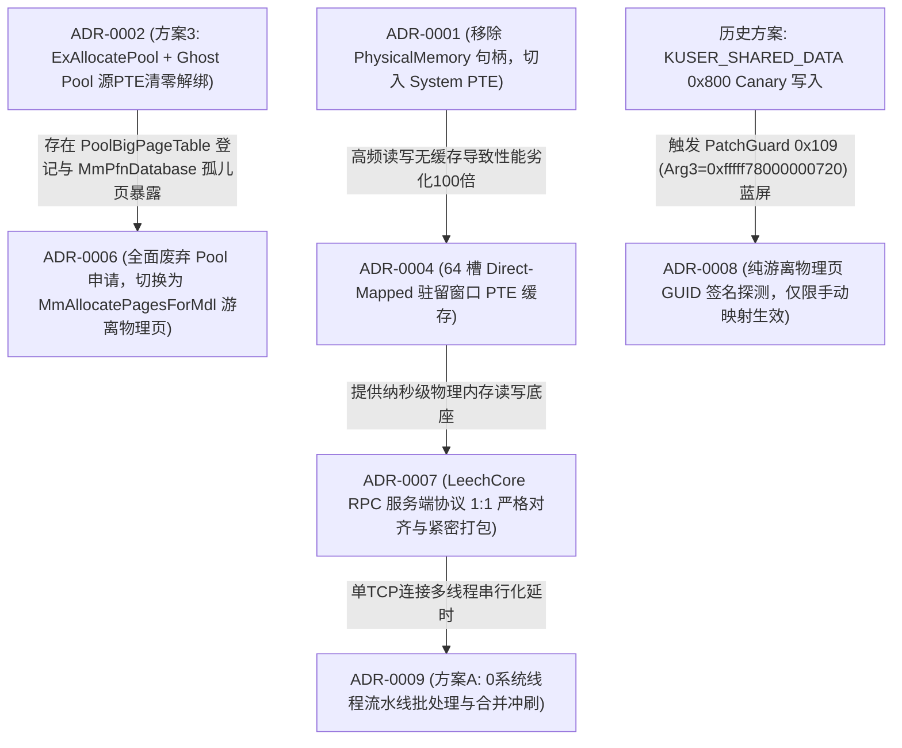

# CheatDrv 架构决策记录索引 (Architecture Decision Records)

本文档是 `CheatDrv` 项目所有关键架构决策、通信协议规范、系统级负向知识与避坑铁律的全局总索引。
**【AI 助手与研发团队铁律】**：在进行任何内核方案设计、协议重构、以及排查内核崩溃（BSOD/BugCheck）之前，**必须首先查阅本索引表与对应 ADR 正文**，严禁引入已被废弃的历史方案，严禁违反已知约束。

---

## 一、 架构决策速查总表

| ADR 编号 | 决策标题 | 核心领域 | 状态 | 核心技术要点 | 关键避坑与负向知识 |
| :--- | :--- | :--- | :--- | :--- | :--- |
| [**ADR-0001**](0001-iat-clean-and-hal-removal.md) | 驱动 IAT 导入表极致净化与 HAL 依赖彻底剥离 | 内核安全 / 静态免杀 | **已采纳** | 剥离 `HAL.dll`（CPU 自旋替代 `KeStallExecutionProcessor`）；内存分配与 IRP 全量动态化重定向；CR8 读取 IRQL | 严禁在驱动源码全局 `#define` 系统导出（如 `ObfDereferenceObject`），防止污染 WDK 头文件；IAT 仅保留 `__C_specific_handler` |
| [**ADR-0002**](0002-pte-remap-stealth-and-ace-mitigation.md) | PTE Remap 驱动高隐匿性架构改造与反作弊(ACE)规避规范 | 内存挂接 / 隐蔽注入 | **部分被替代** | JIT 动态翻转 `NX` 标志（微秒级执行窗口）；本地单核 TLB 刷新；纯叶子平栈中继；`PsInvertedFunctionTable` 启发式接管 | 严禁改 `CR0.WP` 强写（触碰 HVCI）；严禁侵入 `.rsrc` 节；严禁寄生于 `tcpip.sys`；*(注：第 6 条 Ghost Pool 解绑方案已被 ADR-0006 替代)* |
| [**ADR-0003**](0003-wechat-memory-parser-precision-model.md) | 微信 64 位内存数据解析模型重构与结构对齐 | 应用层逆向 / 内存解析 | **已采纳** | 64 位 `std::string` 手机号锚点对齐模型；群聊 `@chatroom` 强类型校验；589 联系人全量双流聚合；高清头像 URL 后向提取 | `std::string` 容量 > 15 为堆指针模式；MSVC CRT `fopen_s` 严禁混用 `"ccs=UTF-8"` 与字节流 `fprintf`（会引发 `0xC0000417` 闪退），需用 `"wb"` + 手动 BOM |
| [**ADR-0004**](0004-pte-cache-and-cr3-hierarchical-caching.md) | 轻量级 System PTE 驻留窗口缓存与 CR3 页表分级缓存架构 | 内核内存读写 / 性能优化 | **已采纳** | 1024 槽黄金平衡 System PTE 驻留窗口 + 斐波那契散列；Sequence Lock 读读无锁直读；阶梯式退避消灭 50ms 争用；RPC 原位直读零拷贝消除池锁争用 | 读写属性严格分离（读操作强制置位最高位 NX，RW=0，写操作 RW=1）；驱动清理时必须原子复原 1024 槽原始 PTE 并释放映射空间；严禁在快/慢路径高频打印 DBG |
| [**ADR-0005**](0005-transport-layer-performance-and-reliability-overhaul.md) | 传输层通信架构重构与性能可靠性加固 (TCP / UDP / USB) | 跨环/跨机网络通信 | **已采纳** | TCP 常驻 IRP 循环重用 (`IoReuseIrp`) 与滑动窗口游标；UDP 1400 字节 MTU 友好型分片重组；USB 流水线非阻塞轮询 | 严禁对常驻 IRP 重入调用；重用必须重置栈指针并重新挂接完成例程；线程退出前必须确保 IRP 处于非挂起态 |
| [**ADR-0006**](0006-headless-mdl-pages-and-pool-removal.md) | 全面废弃 ExAllocatePool 机制与纯游离物理页(MDL)架构决策 | 内存分配 / 反作弊对抗 | **已采纳** | 彻底废除 `ExAllocatePoolWithTag`；引入 `MmAllocatePagesForMdl` 纯游离物理页；宿主原生常驻物理页原位复用；`ScopedThreadAffinity` 绑核 | 严禁使用大池内存（`PoolBigPageTable` 必有记录）；严禁强行清零源 PTE 制造 `MmPfnDatabase` 孤儿页；严禁物理写 `_MMPFN` 结构（会触发 PatchGuard `0x109` 蓝屏） |
| [**ADR-0007**](0007-leechcore-rpc-protocol-1to1-alignment.md) | LeechCore RPC 服务端协议一比一对齐与防错位规范 | 跨环/跨机网络通信 / 协议规范 | **已采纳** | `WriteScatter` 响应严格采用 `cMEMs * sizeof(BOOL)` 布尔数组；`ReadScatter` 实施两阶段紧密打包仅打包成功页（杜绝 Offset Shift）；集成 4 槽 XPRESS 并发压缩与自动解压管道；继承 64 槽 System PTE 读写底座 | 严禁在 WriteScatter 返回全量 `MEM_SCATTER` 结构体；严禁在 ReadScatter 响应中保留失败页空洞数据；严禁硬编码工作区体积（必须动态查询）；严禁解包超过 64MB 防止溢出 |
| [**ADR-0009**](0009-wsk-nng-async-worker-pool-and-multiplexing.md) | WSK NNG 流水线批处理与全双工异步双缓冲发送架构 (Pipeline Batching & Double-Buffered Async Send) | 跨环/跨机网络通信 / 并发优化 | **已采纳** | 彻底废除多工作线程池；纯单线程流水线批处理（0 额外系统线程，100% 免疫反作弊）；4 槽位 1MB 全双工深度环形流水线；100~240 页大跨页 100% DirectOut 原位直写；分发前智能预估与前置异步冲刷（消灭 100% 大池分配与二次 memcpy）；`WSK_FLAG_NODELAY` 即时出网 | 严禁在热路径频繁调用 `ExAllocatePoolWithTag` 导致内核池自旋锁争用；严禁在热路径使用 KeWaitForSingleObject 微秒超时轮询（受限于系统时钟节拍导致 2ms 延迟雪崩）；严禁异步 IRP 完成例程使用局部栈变量上下文（会引发 BugCheck `0xD1`）；WSK 关闭必须原子置空指针防范二次 Close |

---

## 二、 架构演进路线与替代关系

---

## 三、 系统级核心负向知识速查 (Negative Knowledge)

在驱动与加载器开发中，以下为经全量推演与踩坑总结的**绝对禁忌操作**：

1. **蓝屏 BugCheck `0x109` (CRITICAL_STRUCTURE_CORRUPTION)**：
   - 严禁试图物理修改 `nt!MmPfnDatabase` 中的 `_MMPFN` 结构体来伪造页表归属；PatchGuard 会周期性做 DPC 校验。
   - **严禁向 `KUSER_SHARED_DATA`（`0xFFFFF78000000000`）写入任何数据**：现代 Windows 10/11 的 PatchGuard 会对整页 `_KUSER_SHARED_DATA` 进行加密哈希校验；在 `0x800` 等空闲偏移写入会导致运行约 20 分钟后触发 `0x109` 蓝屏（Arg3=0xfffff78000000720），必须采用 ADR-0008 游离物理页方案。
2. **蓝屏 BugCheck `0x1E` / `0x4E` (PFN_LIST_CORRUPT) / `0xBE` (ATTEMPTED_WRITE_TO_READONLY_MEMORY)**：
   - 现代 Windows 10/11 开启 HVCI 场景下，严禁通过修改 `CR0.WP` 强写只读内存；
   - 写入内核页前必须通过物理页表设置 `PTE.RW = 1`，并在写入后及时还原。
3. **蓝屏 BugCheck `0xFC` (ATTEMPTED_EXECUTE_OF_NOEXECUTE_MEMORY)**：
   - 代码执行落点所在的 PTE 必须物理清除最高位 `PTE.NX`（置 0）；
   - 挂接探针前必须使用 `ScopedThreadAffinity` 锁定单核，防止核间调度导致多核 TLB 视图不同步。
4. **蓝屏 BugCheck `0xD1` (DRIVER_IRQL_NOT_LESS_OR_EQUAL)**：
   - 严禁将函数的局部栈变量用作异步 IRP 完成例程的上下文参数（`IoSetCompletionRoutine` 中的 `Context`）；
   - 异步 I/O 在返回 `STATUS_PENDING` 时主函数退栈导致上下文栈内存失效，随后在 DPC / `DISPATCH_LEVEL` 回调完成例程时将触发野指针解引用（如 `call [rax+140h]`）引发 `0xD1` 蓝屏；完成例程上下文必须在宿主堆结构中常驻分配与生命周期绑定（ADR-0009 第 17 条）。
5. **反作弊检出靶点 (ACE / EAC / Vanguard)**：
   - **大池表**：任何大于 4KB 的 `ExAllocatePool*` 必然登记在 `nt!PoolBigPageTable` 中，不可作为隐蔽代码载体；
   - **系统线程创建**：严禁在内核态直接调用 `PsCreateSystemThread` 创建匿名工作线程池，会触发反作弊 `PsSetCreateThreadNotifyRoutine` 深度审计 StartAddress 归属；多线程并发吞吐必须通过 ADR-0009 流水线批处理与合并冲刷解决；
   - **PE 头篡改**：严禁篡改宿主白驱动的 DOS/NT 头部与 `.pdata` 异常表；必须采用 Leaf 纯叶子平栈退出；
   - **资源节**：严禁借用 `.rsrc` 节区（白驱动资源目录被文件完整性哈希严格校验）。

---

## 四、 维护与新增规范
当触发以下事件之一时，必须在此目录下新建 `XXXX-简要描述.md`，并同步更新本索引表：
1. 核心内核 API 族系增删与替换；
2. 跨环通信协议号、结构体字段或内存对齐变更；
3. 系统级负向知识（蓝屏 BugCheck 解决与死锁踩坑）；
4. 反作弊对抗机制重大重构。
