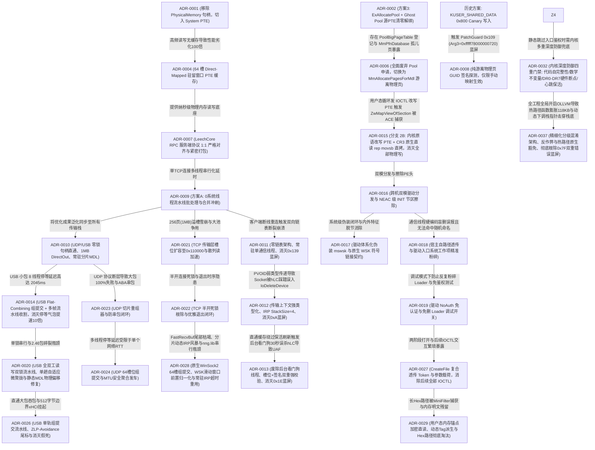

# CheatDrv 架构决策记录索引 (Architecture Decision Records)

本文档是 `CheatDrv` 项目所有关键架构决策、通信协议规范、系统级负向知识与避坑铁律的全局总索引。
**【AI 助手与研发团队铁律】**：在进行任何内核方案设计、协议重构、以及排查内核崩溃（BSOD/BugCheck）之前，**必须首先查阅本索引表与对应 ADR 正文**，严禁引入已被废弃的历史方案，严禁违反已知约束。

---

## 一、 架构决策速查总表

| ADR 编号 | 决策标题 | 核心领域 | 状态 | 核心技术要点 | 关键避坑与负向知识 |
| :--- | :--- | :--- | :--- | :--- | :--- |
| [**ADR-0001**](0001-iat-clean-and-hal-removal.md) | 驱动 IAT 导入表极致净化与 HAL 依赖彻底剥离 | 内核安全 / 静态免杀 | **已采纳** | 剥离 `HAL.dll`（CPU 自旋替代 `KeStallExecutionProcessor`）；内存分配与 IRP 全量动态化重定向；CR8 读取 IRQL | 严禁在驱动源码全局 `#define` 系统导出（如 `ObfDereferenceObject`），防止污染 WDK 头文件；IAT 仅保留 `__C_specific_handler` |
| [**ADR-0002**](0002-pte-remap-stealth-and-ace-mitigation.md) | PTE Remap 驱动高隐匿性架构改造与反作弊(ACE)规避规范 | 内存挂接 / 隐蔽注入 | **部分被替代** | JIT 动态翻转 `NX` 标志（微秒级执行窗口）；本地单核 TLB 刷新；纯叶子平栈中继；`PsInvertedFunctionTable` 启发式接管 | 严禁改 `CR0.WP` 强写（触碰 HVCI）；严禁侵入 `.rsrc` 节；严禁寄生于 `tcpip.sys`；*(注：第 6 条 Ghost Pool 解绑方案已被 ADR-0006 替代)* |
| [**ADR-0003**](0003-wechat-memory-parser-precision-model.md) | 微信 64 位内存数据解析模型重构与结构对齐 | 应用层逆向 / 内存解析 | **已采纳** | 64 位 `std::string` 手机号锚点对齐模型；群聊 `@chatroom` 强类型校验；589 联系人全量双流聚合；高清头像 URL 后向提取 | `std::string` 容量 > 15 为堆指针模式；MSVC CRT `fopen_s` 严禁混用 `"ccs=UTF-8"` 与字节流 `fprintf`（会引发 `0xC0000417` 闪退），需用 `"wb"` + 手动 BOM |
| [**ADR-0004**](0004-pte-cache-and-cr3-hierarchical-caching.md) | 轻量级 System PTE 驻留窗口缓存与 CR3 页表分级缓存架构 | 内核内存读写 / 性能优化 | **已采纳** | 1024 槽黄金平衡 System PTE 驻留窗口 + 斐波那契散列；Sequence Lock 读读无锁直读；阶梯式退避消灭 50ms 争用；RPC 原位直读零拷贝消除池锁争用 | 读写属性严格分离（读操作强制置位最高位 NX，RW=0，写操作 RW=1）；驱动清理时必须原子复原 1024 槽原始 PTE 并释放映射空间；严禁在快/慢路径高频打印 DBG |
| [**ADR-0005**](0005-transport-layer-performance-and-reliability-overhaul.md) | 传输层通信架构重构与性能可靠性加固 (TCP / UDP / USB) | 跨环/跨机网络通信 | **已采纳** | TCP 常驻 IRP 循环重用 (`IoReuseIrp`) 与滑动窗口游标；UDP 1400 字节 MTU 友好型分片重组；USB 流水线非阻塞轮询 | 严禁对常驻 IRP 重入调用；重用必须重置栈指针并重新挂接完成例程；线程退出前必须确保 IRP 处于非挂起态 |
| [**ADR-0006**](0006-headless-mdl-pages-and-pool-removal.md) | 全面废弃 ExAllocatePool 机制与纯游离物理页(MDL)架构决策 | 内存分配 / 反作弊对抗 | **已采纳** | 彻底废除 `ExAllocatePoolWithTag`；引入 `MmAllocatePagesForMdl` 纯游离物理页；宿主原生常驻物理页原位复用；`ScopedThreadAffinity` 绑核 | 严禁使用大池内存（`PoolBigPageTable` 必有记录）；严禁强行清零源 PTE 制造 `MmPfnDatabase` 孤儿页；严禁物理写 `_MMPFN` 结构（会触发 PatchGuard `0x109` 蓝屏） |
| [**ADR-0007**](0007-leechcore-rpc-protocol-1to1-alignment.md) | LeechCore RPC 服务端协议一比一对齐与防错位规范 | 跨环/跨机网络通信 / 协议规范 | **已采纳** | `WriteScatter` 响应严格采用 `cMEMs * sizeof(BOOL)` 布尔数组；`ReadScatter` 实施两阶段紧密打包仅打包成功页（杜绝 Offset Shift）；集成 4 槽 XPRESS 并发压缩与自动解压管道；继承 64 槽 System PTE 读写底座 | 严禁在 WriteScatter 返回全量 `MEM_SCATTER` 结构体；严禁在 ReadScatter 响应中保留失败页空洞数据；严禁硬编码工作区体积（必须动态查询）；严禁解包超过 64MB 防止溢出 |
| [**ADR-0009**](0009-wsk-nng-async-worker-pool-and-multiplexing.md) | WSK NNG 流水线批处理与全双工异步双缓冲发送架构 (Pipeline Batching & Double-Buffered Async Send) | 跨环/跨机网络通信 / 并发优化 | **已采纳** | 彻底废除多工作线程池；纯单线程流水线批处理（0 额外系统线程，100% 免疫反作弊）；4 槽位 1MB 全双工深度环形流水线；100~240 页大跨页 100% DirectOut 原位直写；分发前智能预估与前置异步冲刷（消灭 100% 大池分配与二次 memcpy）；`WSK_FLAG_NODELAY` 即时出网 | 严禁在热路径频繁调用 `ExAllocatePoolWithTag` 导致内核池自旋锁争用；严禁在热路径使用 KeWaitForSingleObject 微秒超时轮询（受限于系统时钟节拍导致 2ms 延迟雪崩）；严禁异步 IRP 完成例程使用局部栈变量上下文（会引发 BugCheck `0xD1`）；WSK 关闭必须原子置空指针防范二次 Close |
| [**ADR-0010**](0010-transport-layer-unified-optimization-udp-usb.md) | 全传输层高性能优化同步与统一直通架构 (UDP & USB Transport Layer Optimization) | 跨环/跨机网络通信 / 传输层统一 | **已采纳** | 统一抽象 `MK_TRANSPORT_CONTEXT` 通用直通上下文；UDP/USB 零锁句柄直通消灭互斥体争用；UDP 扩容至 1MB 支持 100% DirectOut 原位直写；UDP 常驻 `pSliceBuf` + 预构建 MDL 彻底消灭分片热路径动态分配；USB 全双工双缓冲重叠 I/O 流水线 (`UsbHub_BulkWriteAsync` + `UsbHub_BulkReadFast`，常驻 IRP / MDL 0 动态申请，消灭 250 微秒单管停等气泡) | 严禁在传输服务端停止时遗留旧句柄缓存（必须显式置空）；UDP 切片必须遵循 `MK_UDP_SLICE_HDR` 契约；严禁引入额外内核线程 |
| [**ADR-0011**](0011-zero-list-permanent-thread-and-corrupt-entry-bsod.md) | 零链表架构、常驻单线程模型与彻底根除 BugCheck 0x139 (FAST_FAIL_CORRUPT_LIST_ENTRY) | 网络通信架构 / 系统崩溃根治 | **已采纳** | 彻底废除 `LIST_ENTRY` 双向链表与多客户端并发模型；驱动全生命周期仅创建单个常驻系统线程（`WskServerThread`）；单例 5.2MB 上下文一次性预分配与持久化复用；串行 Accept 阻塞唤醒 | 严禁在网络断线重连等动态生命周期中使用裸 `LIST_ENTRY`（内核 `int 29h` 完整性校验极易引发 `0x139` 蓝屏）；严禁在客户端接入时动态调用 `PsCreateSystemThread` 触发反作弊深度审计；大尺寸缓冲严禁高频申请释放 |
| [**ADR-0012**](0012-wsk-transport-context-corruption-and-stack-underflow-bsod-0xa.md) | 传输层通用直通上下文强类型化与彻底根除 BugCheck 0xA (IRQL_NOT_LESS_OR_EQUAL) | 跨环网络通信 / 系统崩溃根治 / 类型安全防御 | **已采纳** | `PMK_TRANSPORT_CONTEXT` 强类型化废除 `PVOID` 传递；`MK_WSK_CLIENT` 嵌入 `TransportCtx` 彻底隔离 `Socket` 偏移；IRP `StackSize` 统一由 1 升至 4 防止下层过滤驱动栈下溢；内核规范高半区指针校验 | 严禁使用弱类型 `PVOID` 传递包含可写成员的跨层上下文（导致结构体偏移错位踩踏对象首字段）；IRP 栈大小严禁写死 1；套接字派遣前必须强校验规范指针地址 |
| [**ADR-0013**](0013-rpc-handle-uaf-and-inactivity-watcher-removal-bsod-0x1e.md) | 废除 RPC 后台超时看门狗线程、句柄槽位双向强校验与彻底根除 BugCheck 0x1E (Use-After-Free) | 跨环网络通信 / 生命周期管理 / 系统崩溃根治 | **已采纳** | 彻底废除 `LeechRPC_LcHandle_InactivityWatcherThread` 后台线程；`Cached_hLC` 绑定 `ClientList` 槽位与 `LC_CONTEXT_VERSION` 签名双重无锁校验；`SharedUserData` 零开销刷新时间戳；`LcClose` 释放前清零签名与函数表 | 严禁快路径缓存绕过保活时间戳更新导致后台线程 30 秒误杀活跃句柄（引发 `LcReadScatter` UAF `0x1E` 蓝屏）；严禁未校验 `LC_CONTEXT_VERSION` 与规范地址直接间接调用 `pfnReadScatter` |
| [**ADR-0014**](0014-usb-transport-group-commit-and-pipeline-batching.md) | USB 传输层 Flat-Combining 组提交与流水线批处理合并回包架构 (Group Commit & Pipeline Batching) | 跨机/跨环 USB 通信 / 并发优化 | **已采纳** | 客户端 Flat-Combining 组提交（64 静态槽位 + Leader 批量打包 + 1 次 WinUsb 发送/接收 + Nonce 映射唤醒）；驱动端多帧流水线滑动收割与合并回包；原样回传 `qwReqNonce`；大包直通旁路保证 157 MB/s 零退化；IRP StackSize=4 纵深防御 | 严禁在组提交中使用动态内存分配或链表；严禁在持有 `QueueLock` 时执行物理 I/O；大包必须走独占硬件直通通道；驱动必须原样回传 Nonce |
| [**ADR-0015**](0015-branch-2b-kernel-pte-remap-and-direct-copy-pipeline.md) | 宿主驱动原位 PTE 缝合、CR3 进程直读特权与彻底根除 ZwMapViewOfSection 反作弊特征 (Branch 2B Architecture) | 内核隐蔽注入 / 反作弊(ACE)规避 / 内存挂接架构 | **已采纳** | 借用 Loader 线程当前 CR3 直读特权；3 微秒 `rep movsb` 硬件级搬移镜像；内核原语 `MmAllocatePagesForMdl` + `MmMapIoSpace` 闭环重映射 PTE；单次未知 IOCTL 触发；用户态物理写次数与 `ZwMapViewOfSection` 彻底归零 | 严禁在用户态频繁调用工具驱动物理写 IOCTL（触发反作弊 `\Device\PhysicalMemory` 句柄监控）；Shellcode 严格限制在 333 字节内防止溢出 463 字节 Code Cave 红线；保持跳回宿主现场恢复 `rdi` |
| [**ADR-0016**](0016-dual-mode-driver-dispatch-and-neac-init-wiping.md) | 跨机双模驱动分发、自适应加载决策与 NEAC 级 INIT 节区擦除生命周期闭环 | 跨机通信 / 驱动加载与反转储 / 生命周期治理 | **已采纳** | 云端 `core_driver` 与 `driver_mode` (1正常/2映射) 纳管分发；B 机跨机动态参数与载荷投递；`host_loader` 正常模式绝不释放 `Machenike.sys` 白驱动；驱动尾部 NEAC Discardable INIT 节区与 PE 头部物理清零；就绪后 `host_loader` 延时 500ms 自动退出消除进程审计 | 模式 1 严禁落地白驱动；`host_loader` 发完 ACK 必须等待 500ms 防止 TCP 栈发送 RST 报文导致 B 机 10054 错误；INIT 擦除必须经 `MmIsAddressValid` 校验 |
| [**ADR-0017**](0017-system-wsk-driver-and-device-stealth-disguise.md) | 驱动体系化伪装、原生 WSK 符号链接契约与特征脱节消除 | 反作弊对抗 / 符号伪装 / 架构精简 | **已采纳** | 驱动文件重构为原生系统语义 `mswsk.sys`；SCM 服务名为 `mswsk`；内核设备对象 `\Device\MsNetEndpoint` 与符号链接 `\DosDevices\MsNetEndpoint` 统一切换消除 0xC0000035 冲突；消除旧白驱动残留变量与两次分支重复代码 | 跨端打开路径必须严格对齐 `\\.\MsNetEndpoint`；驱动卸载必须成对销毁设备与符号；严禁使用第三方特征前缀驱动名 |
| [**ADR-0018**](0018-targeted-host-loader-deletion-via-system-worker-item.md) | 废除常驻线程硬编码盲删、宿主加载器自路径透传与驱动入口系统工作项精准粉碎 | 反作弊对抗 / 痕迹清理 / 跨环契约 | **已采纳** | 废除 `WskServerThread` 启动时硬编码候选路径盲删；扩展 `DRV_BOOT_CONFIG_EX` 透传真实路径；宿主加载器通过 `GetModuleFileNameW` 自提取并下发；驱动入口挂靠系统工作线程（System Worker Thread）记录调用方 PID 并循环探测进程生命周期（200ms 步长，超时 10 秒退出，退出确认后粉碎文件） | 严禁破坏 `ShellcodeParams` 120 字节对齐（必须通过派生结构体扩展）；文件打开必须强制 `OBJ_KERNEL_HANDLE`；必须循环轮询等待宿主完全退出释放执行句柄，超时必须主动安全退出线程防死锁 |
| [**ADR-0019**](0019-no-auth-debug-mode-and-loader-preservation.md) | 驱动 NoAuth 免认证与免删 Loader 调试开关规范 | 跨环通信契约 / 调试模式治理 / 痕迹清理控制 | **部分被替代** | 引入 `NO_AUTH` / `ENABLE_NO_AUTH` 宏开关；跳过 `MachenikeDispatchCreate` 文件名 Token 计算与 `IOCTL_MK_START_TRANSPORT` 魔数拒绝；驱动入口跳过系统工作项删除 Loader 保留二进制现场 | 生产发布环境严禁使能；宿主删除逻辑被 ADR-0044 彻底解耦，改由 Flags 动态位掩码控制 |
| [**ADR-0020**](0020-usb-transport-full-duplex-pipeline-and-micro-coalescing.md) | USB 传输层全双工读写双锁流水线、单趟自适应微聚拢与静态 MDL 物理偏移修复 | 跨机/跨环 USB 通信 / 并发优化 / 系统稳定性 | **已采纳** | 驱动端修复 `cbRemain > 0` 静态 MDL 覆写与双缓冲 **Wait-Before-Write** 在飞 DMA 踩踏；发送槽扩容至 `0x110000`；客户端单趟交接、15µs 微聚拢、SendLock/RecvLock 全双工重叠；大包直通统一接入 `cbRecvRemain` 与在飞 Nonce 互助分发根除 121 超时 | 静态 MDL 严禁传入带偏移地址或置空 MDL；双缓冲严禁未 `WaitWriteSlot` 先覆写 `pbDirectOut`；严禁开启 `RAW_IO` 破坏非对齐续读 |
| [**ADR-0021**](0021-tcp-wsk-pipeline-slot-expansion-and-scatter-read-acceleration.md) | TCP 传输层槽位扩容、消灭 1MB 溢槽雪崩与散列读请求零分配加速 | 跨机/跨环 TCP 通信 / 性能优化 / 内存分配优化 | **已采纳** | 驱动端单发送槽位 `MK_WSK_SEND_SLOT_SIZE` 与压缩缓冲扩容至 `0x110000` (1MB+64KB)；256 页（整 1MB 数据）散列读 100% 命中 DirectOut 原位直写与 4 槽位全双工异步发送；客户端剥离 `READSCATTER_REQ` 画蛇添足压缩，消灭驱动端高频动态池解压；移除物理读热路径高频 DBG 打印与冗余清零 | 传输层单帧最大有效载荷计算必须包含协议头与元数据，严禁槽位尺寸刚好等于数据纯载荷（导致溢出）；只对写载荷启用压缩，严禁压缩只读地址描述符 |
| [**ADR-0022**](0022-tcp-wsk-nng-stability-and-deadlock-prevention.md) | TCP (WSK/NNG) 传输层半开死锁根除与优雅退出防挂起闭环 | 跨机/跨环 TCP 通信 / 稳定性与死锁防护 | **已采纳** | 客户端补全 `SetOption` 漏发调用；TLS 绑定当前 `sock.id` 防止断线重连失效并禁止全局 `TlsFree`；驱动端分包读取全链路启用 10 秒超时（`WskSyncReceiveTimed`）根除半开连接假死；`Cleanup` 遵循“先 Close Socket 后 Drain Pending Send”铁律，并在 `WskDrainPendingSend` 引入 5 秒超时与 `IoCancelIrp` 双重防死锁兜底；发送大包前排空异步流水线 | 退出清理严禁先 Drain 后 Close（未决 IRP 依赖对端 ACK 会导致永久死锁）；网络分包接收严禁无超时无限等待 |
| [**ADR-0023**](0023-udp-transport-slice-reassembly-and-aba-prevention.md) | UDP 传输层协议断层修复、零拷贝分片重组器与防串包闭环 | 跨机/跨环 UDP 通信 / 协议对齐 / 系统稳定性 | **已采纳** | 客户端实现 `MK_UDP_SLICE_HDR` (`'UDPS'`) 零拷贝分片重组器，彻底修复 $\ge 4\text{KB}$ 大包通信 100% 失败；驱动端响应严格回传 `qwReqNonce` 结合客户端 Nonce 断言消灭 ABA 串包；升级 `udp_discovery.c` 为 `StackSize = 4` 消除蓝屏隐患；全局持久化静态缓冲消除 128KB 局部栈开销；开启 UDP XPRESS 硬件线速压缩并将 `dwMaxChunk` 扩容至 128 页 | UDP 切片传输中客户端严禁缺失重组协议；无连接 UDP RPC 响应严禁回填随机 Nonce（必须回传请求原 Nonce） |
| [**ADR-0024**](0024-udp-flat-combining-group-commit-and-pipeline-aggregation.md) | UDP 传输层 Flat-Combining 组提交与 MTU 安全聚合发车架构 | 跨机/跨环 UDP 通信 / 并发性能优化 | **已采纳** | 客户端 64 槽位 Flat-Combining 组提交；严格受限于 1400 字节 MTU 安全聚合发车；驱动端多帧流水线连续收割与合并回传；客户端批量解包与 Nonce 精准匹配分发；`Leader Handoff` 平滑交接彻底根除末班车孤儿死锁；大包独占通道零退化 | 客户端聚合发车与服务端合并回传严格 $\le 1400$ 字节，严禁溢出导致 IP 分片丢包；必须通过 64 位 Nonce 强断言匹配对应槽位，严禁隐式顺序匹配 |
| [**ADR-0025**](0025-dispatch-create-dynamic-token-auth-and-loader-alignment.md) | 驱动端 IRP_MJ_CREATE 动态 Token 防伪接入与加载器全链路协同 | 访问控制 / 动态 Token / 跨环契约 | **已采纳** | 挂接 `MachenikeDispatchCreate` 验证时间戳 Token；增强 `UserVar` 空指针防御（回退 `g_pGlobalUserVar`）；SCM/Host 加载器全链路提供 `OpenDriverDeviceCompatible` 支持 `[-1, 0, 1]` 窗口 Token 计算与 NoAuth 裸路径平滑降级；前端移除选择模式自动盲连 | 跨环打开时必须具备时间窗口容差；生产环境严格受 `NO_AUTH 0` 约束；修改源码必须运行 `convert_bom.py` 保证 UTF-8 BOM 编码 |
| [**ADR-0026**](0026-usb-single-pipeline-and-zlp-avoidance-trailer.md) | USB 传输层单轨组提交流水线、ZLP-Avoidance 尾标与周期性假死挂起彻底根除 | 跨机/跨环 USB 通信 / 协议契约 / 稳定性根治 | **已采纳** | 废除 `fLargeReq` 双轨制，所有请求 100% 登记入 `Slots[64]` 并支持 `pbCallerBuf` 零分配接收；Leader 实施单槽水位上限（`MAX_BATCH_EST_RSP = 0xE0000`）根除双槽满载死锁；驱动发送满 512/1024B 追加 12B 全零短包尾标；接收长度强制按 `& ~0x3FFU` 对齐 1024B；USB 并发小页合并保持整波满载聚拢 (`targetWave = peakNow`) | 严禁绕过全局槽位独立收发；严禁无上限批量收割超出驱动单槽容量 `0x110000`；USB 读取长度必须向下对齐 1024B；严禁在 USB 半双工管道上拆半波或 `SendLock` 后提前交接 Leader |
| [**ADR-0027**](0027-createfile-token-payload-pipeline-and-ioctl-elimination.md) | 驱动 CreateFile 阶段 Token 与参数复合透传及 IOCTL 彻底消除规范 | 跨环通信契约 / 鉴权与极简架构 | **已采纳** | 驱动端 `DispatchCreate` 优先校验 Token 防伪，通过后解析复合路径 HexPayload 直接激活服务；Loader 默认一次性透传 Token 与参数并立即释放句柄，彻底消除 `IOCTL_MK_START_TRANSPORT` 与 `IOCTL_MK_GET_STATUS` | 严禁跳过 Token 校验短路处理 HexPayload；驱动启动服务失败必须赋回 NTSTATUS 错误状态；严禁在激活后遗留无用 IOCTL 交互 |
| [**ADR-0028**](0028-tcp-native-group-commit-and-wsk-sliding-window-fix.md) | TCP 传输层原生 WinSock2 组提交重构、WSK 滑动窗口尾部枯竭根治与常驻 IRP 超时重用 | 跨机/跨环 TCP 通信 / 并发优化 / 依赖剥离 | **已采纳** | 彻底剥离 `nng.lib`/`mbedtls`，客户端原生实现 NNG SP 线协议、64 槽位全双工组提交、`pbCallerBuf` 零分配接收、8 路组相联页微缓存 (`128 Sets × 8 Ways`) 与 `uniqueMEMs` 跨线程去重合并；驱动端修复 `>=12B` 半包绕过归一化导致的 `FastRecvBuf` 尾部枯竭，常驻 `pRecvIrp` 100% 超时重用；`>=4KB` 全量无锁 XPRESS 压缩 | 常驻 IRP 超时取消后必须同步等待 `Sync.pEvent` 回收所有权方可重用；微缓存与波次聚拢严禁仅看瞬时 `cActiveThreads`（需用线程 ID 时间窗防并发度塌缩与 1-Way 哈希冲突） |
| [**ADR-0029**](0029-user-mode-memory-anchor-encrypted-payload.md) | 用户态内存锚点加密传输、动态 Tag 直读与 Hex 路径彻底淘汰规范 | 跨环通信契约 / 反作弊规避 / 内存加密 | **已采纳** | 用户态 `.data` 节区建立 `DRV_USER_PAYLOAD_ANCHOR` 静态锚点；动态 Token 派生 `Tag0/Tag1` 消灭静态特征码；RC4 密文传输；驱动 `MachenikeDispatchCreate` 原生 CR3 上下文节区直读解密；内核特权物理清零用户态内存实现“阅后即焚”；彻底淘汰 HexPayload 路径 | 节区扫描必须置于 `PASSIVE_LEVEL` 且由 `__try/__except` 强保护；用户态结构体必须 16 字节对齐且驻留在读写数据节；严禁保留老旧 Hex 路径代码 |
| [**ADR-0030**](0030-pure-static-class-modular-architecture-refactor.md) | 驱动全模块纯静态类封装与功能子目录架构解耦规范 | 架构重构 / 纯静态类 / 模块化解耦 | **已采纳** | 驱动按六大高内聚模块规划功能子目录（`Core/`, `Security/`, `Diagnostics/`, `Memory/`, `Transport/`, `Stealth/`）；全量抽象为纯静态类（`DriverCore`, `DrvSecurity`, `Utils`, `ExceptionReporter`, `LeechCoreEngine`, `RpcDispatcher`, `TransportManager`, `StealthReloc`, `WfpBypass`, `NetMonitor`）；0 虚函数（无 vtable 反作弊特征）、0 动态实例、0 单行垫片；`Main.cpp` 极简收敛直调；彻底清除历史死代码 | 严禁声明虚函数产生 vtable 靶点；类定义必须置于 `#ifdef __cplusplus` 防止纯 C 模块报错；跨目录头文件统一由 MSBuild 包含目录注入；源码必须维持 UTF-8 BOM 编码 |
| [**ADR-0031**](0031-kdf-dynamic-session-crypt-and-anti-patch.md) | 鉴权因子强绑定 KDF 动态通信密钥与去分支化抗 Patch 架构 | 鉴权与防破解 / 跨环协议 / 加密通信 | **已采纳** | 彻底废除全工程写死静态密钥；驱动由 `SessionToken` 经 SipHash-2-4 实时推导 `SessionCryptKey`；`wsk/udp/usb` 传输全链路去分支化加解密；客户端（`leechcore`）支持 URL `k=` 解析与 API 动态下发；入口 Patch 即静默瘫痪物理读写 | 传输层密钥读取必须支持在任意 IRQL 下并发原子直读；空/无效 Token 严禁命中默认密钥，确保非法调用链路彻底错乱 |
| [**ADR-0032**](0032-multi-layered-anti-tamper-integrity-and-hardware-audit.md) | 内核深度防御四重门禁（代码自完整性、控制流数学不变量、DR0-DR7硬件断点自检与双向心跳保活） | 内存保护 / 反逆向对抗 / 完整性防御 | **已采纳** | 核心例程代码前 64 字节 Adler32 动态交叉自检；基于代数同余模型的控制流数学不变量；MSVC `__readdr(7)` / `__readdr(0..3)` 硬件断点审计；60 秒双向 RPC 心跳超时阻断；任何一项违背立即将 `SessionCryptKey` 归零阻断读写 | 所有防御原语均为无锁纯计算，严格受限于非分页只读代码段内部采样，绝不调用阻塞 API，兼容 IRQL PASSIVE 至 DISPATCH |
| [**ADR-0033**](0033-read-only-net-usb-hook-monitor-and-deduplicated-alarm.md) | 网络与 USB 全链路 10 秒只读 Hook 审计、去中和化与单次去重上报引擎 | 反作弊对抗 / Hook 审计 / 只读防御 | **已采纳** | 彻底删除 `usb_hub.c` 中和脱钩代码，100% 只读巡检；扩展 `GetInlineHookTarget` 解码 ROP/双 Push/短跳；监控 `pacer` 及 WFP Callout 动态重挂钩；纯静态类 `UsbMonitor` 覆盖 5 大 USB 核心驱动；纯静态位图单次去重防抖上报；2s*5=10s 严格节拍调度 | 严禁写第三方驱动指针（触碰 PatchGuard 0x109 与 HVCI 0xBE）；对象遍历必须受限于 PASSIVE_LEVEL 并由 `__try/__except` 强保护；成对调用 `ObfDereferenceObject` 防止对象悬挂 |
| [**ADR-0034**](0034-zero-iat-full-dynamic-api-resolution-and-seh-trampoline.md) | 驱动全链路 Zero IAT 架构设计、全量动态 API 解析与本地 SEH 转发桩 | 反作弊对抗 / 静态免杀 / Zero IAT | **已采纳** | 全量扩展 ntoskrnl 与 cng.sys（13个 BCrypt 函数）哈希与函数表；DriverCore 导出表动态解算；零 CRT 安全字符串实现；本地 `__C_specific_handler` 异常分发桩阻断编译器静态导入；`/Gs9999999` 消除 `__chkstk`；达成真正的 100% 0 导入表（Import Directory 与 IAT Directory 尺寸均为 0） | 严禁定义与系统 API 同名宏污染结构体字段；`g_pGlobalUserVar` 必须在入口初始化并在卸载时原子置空；PE 目录项必须经 dumpbin 强断言为 0；动态解析哈希必须严格基于项目原生乘法哈希（`Utils::HashStringA`，因子 `0x1003f` 且忽略大小写），严禁混用 Jenkins 等其他算法导致查找失败 |
| [**ADR-0035**](0035-llvm-msvc-ex-obfuscation-and-releasellvm-build-mode.md) | LLVM-MSVC-EX 混淆工具链集成、ReleaseLLVM 独立编译模式与零导入（Zero IAT）闭环 | 编译体系 / 代码混淆 / 静态免杀 / 符号治理 | **已采纳** | 在 `Machenike.vcxproj` 中新增 `ReleaseLLVM|x64` 配置；指定 `clang-cl.exe` 注入字符串加密、常量混淆、虚假控制流与 MBA 替换；强制绑定 `lld-link.exe` 根除 MSVC `link.exe` 的 COMDAT 损坏（LNK1143）；注入 `-mno-stack-arg-probe` 配合内联安全字符串消除 `__chkstk` 与 `strlen` 外部符号残留；达成 100% 0 导入表（Zero IAT）且与原生 Release 模式隔离 | 链接经过 OLLVM 混淆的目标文件严禁使用原生 `link.exe`；严禁移除栈探针抑制参数（防止引入隐式 `__chkstk`）；双模式配置必须严格独立，严禁破坏默认 Release 的 MSVC 构建流程 |
| [**ADR-0036**](0036-zwmapviewofsection-and-high-risk-api-hook-monitor.md) | ZwMapViewOfSection 动态接入与 28 项高危敏感函数四维只读 Hook 监控引擎 | 反作弊对抗 / Hook 审计 / Zero IAT | **已采纳** | 动态接入 `ZwMapViewOfSection`/`ZwUnmapViewOfSection` 并统一收敛 7 个散落高危函数至 `MACHENIKE_PFN`；构建纯静态类 `ApiMonitor` 聚焦 28 个核心高危敏感 API，实施 EAT 篡改、32B Inline/Adler32 基线、SSDT (`Zw*->Nt*`) 双端穿透与 5 大通信/USB 驱动 IAT 四维 100% 只读巡检及位图去重上报 | 严禁扫描已被回收的 `INIT` 节区（防 `0x50` 蓝屏）；严禁强写还原系统驱动/内核只读页（防 PatchGuard `0x109` 与 HVCI `0xBE`）；`FunctionArray` 顺序必须与 `MACHENIKE_PFN` 严格对齐 |
| [**ADR-0037**](0037-fine-grained-obfuscation-and-stack-exhaustion-bsod-0x7f.md) | 精细化分级混淆架构、反作弊与热路径原生豁免及彻底根除 BugCheck 0x7F (#DF) | 编译优化 / 代码混淆 / 系统稳定性 | **部分被替代** | 全局降噪为仅 `-mllvm --string-obfus`；仅在核心防御模块开启 BCF/MBA 混淆；反作弊三大 Monitor 全面原生豁免 | 被 ADR-0038 纠正：严禁使用 `__attribute__((optnone))` 进行函数级豁免（防止 IR 混淆与 -O0 叠加引发栈溢出） |
| [**ADR-0038**](0038-optnone-ollvm-stack-explosion-bsod-0x7f.md) | 根除 optnone 在 OLLVM 下的灾难性栈溢出 (BugCheck 0x7F #DF) 与基础密码学算力原语架构下沉规范 | 代码混淆 / 栈安全 / 密码学原语架构 | **已采纳** | 彻底禁用 `__attribute__((optnone))`；将 `CalcAdler32`、`SipHash24`、`Rc4Encrypt` 等底层算法原语下沉至原生零混淆单元 `Utils.cpp`；全链路直连，消除 24KB 栈膨胀，实现 0 栈开销高速运算 | 混淆源文件中严禁挂载 `optnone`（防机器码后端禁用优化导致栈槽爆炸）；高频算力原语必须置于原生未混淆文件，确保纯寄存器执行 |
| [**ADR-0039**](0039-ollvm-bcf-loop-stack-explosion-and-crypto-isolation.md) | 彻底根除 OLLVM BCF 虚假基本块循环累加减栈 (BugCheck 0x7F #DF) 与密码学混淆算力隔离架构规范 | 代码混淆 / 栈安全 / 逆向对抗隔离 | **已采纳** | 复杂业务与长跨度扫描文件（`DrvSecurity.cpp`）彻底移除 `-mllvm --bcf`，杜绝循环内疯狂执行垃圾 `alloca`；核心敏感加解密/签名算法（SipHash24、CalcAdler32、RC4）物理隔离至独立无字符串源文件 `CryptoPrimitives.cpp` 并启用全套深度混淆（栈深稳定在 300 字节）；`Utils.cpp` 维持原生零混淆 | 严禁在带长循环、大局部变量或 SEH 的业务函数中开启 OLLVM `--bcf`；需重度混淆代码必须严格物理隔离在无字符串/无大循环的微型算力文件中；混淆产物必须以 `llvm-objdump -d` 审查单帧栈分配严格 `< 1.5KB` |
| [**ADR-0040**](0040-end-to-end-exception-report-encryption-and-server-decryption.md) | 全端异常上报统一端到端二进制加密与服务端解密规范 | 通信协议 / 加密规范 / 跨环契约 | **已采纳** | 剔除驱动冗余 `plainHex` 中间层，直连明文字节流加密；统一 9 字节安全秘钥与 8 字节动态 Nonce；密文字节流减半；客户端（`DeltaForceVMMInterface`）全量异常捕获与对齐上报；服务端标准解密算法落地与旧报文向下兼容 | 严禁在流加密前做冗余 Hex 编码导致解密结果二次呈现 Hex；异步上报必须受保护防止递归调用自身引发死锁与堆栈溢出 |
| [**ADR-0041**](0041-native-resident-pages-reuse-and-hardware-shellcode.md) | 废除内核 MmMapIoSpace 限制、宿主原生物理页复用与纯硬件级 214 字节直拷 Shellcode 架构 | 内核隐蔽注入 / 内存挂接 / 稳定性保障 | **已采纳** | 废除对 `MmMapIoSpace`（Win10 1803+ 严禁映射系统 RAM 导致 `0xC0000772`）与内核重复申请物理页的依赖；遵循 ADR-0006 Priority 1 原位复用宿主常驻物理页，单次 IOCTL (416B) 将 52 个原生 PTE 标记为 RWX；Shellcode 极致精简至 214 字节纯硬件指令（`invlpg` 逐页刷新 + 3 微秒 `rep movsb` 直拷 + 直调 DriverEntry）；彻底根除内核 API 失败隐患 | 严禁使用 `MmMapIoSpace` 映射常规物理 RAM；单次 IOCTL 仅更新 PTE 属性（416B），严禁通过用户态 IOCTL 循环写物理镜像 |
| [**ADR-0042**](0042-headless-mdl-pages-binding-and-illegal-instruction-bsod-0x1e-elimination.md) | 游离物理页(MDL)挂接宿主节区与彻底根除 BugCheck 0x1E (STATUS_ILLEGAL_INSTRUCTION #UD) 蓝屏 | 内核隐蔽注入 / 内存挂接 / 系统崩溃根治 | **已采纳** | 废除对宿主 Discardable 节区自带常驻物理页的假设；81 字节微型探针 Shellcode (`scAllocMdlProbe`) 单次触发 `MmAllocatePagesForMdl` 申请纯游离物理页；读取 `pMdl + 0x30` PFN 数组并逐页通过 `GetPtePhysAddr` 写入宿主节区 PTE（解决 PFN=0 映射物理 0x0 触发 #UD 0xC000001D）；配合 214 字节硬件直拷 Shellcode 瞬间激活 DriverEntry | 严禁对 PFN 为 0 的未映射 PTE 盲目置位 Present 位；PTE 物理地址定位必须逐页解算防止跨 2MB PDE 页目录边界；探针平栈与寄存器契约严格成对 |
| [**ADR-0043**](0043-periodic-hardware-breakpoint-and-text-integrity-monitoring.md) | 常驻安全工作项硬件断点自检与代码段动态完整性周期巡检规范 | 反作弊对抗 / 内存保护 / 周期巡检 | **已采纳** | 剥离 `MachenikeDispatchCreate` 单次单点防御；复用原生 `ExpWorkerThread`（`SecurityWorkerRoutine`）零新增线程；2s 节拍巡检 CPU `DR0-DR7` 硬件断点；10s 节拍执行 `.text` 代码段 Adler32 动态完整性比对；违规即时熔断 `SessionCryptKey` 并加密上报 | 工作项必须在 `PASSIVE_LEVEL` 运行；自检严禁调用高开销阻塞例程；基线统一在驱动初始化单次固化 |
| [**ADR-0044**](0044-dynamic-host-loader-cleanup-and-security-monitor-switch.md) | 宿主自粉碎标记动态解耦与安全监控扫描引擎编译开关宏规范 | 跨环协议契约 / 痕迹清理控制 / 性能与调试治理 | **已采纳** | 废除驱动端删除 Loader 对 `NO_AUTH` 的编译期绑定；在 `DRV_BOOT_CONFIG.Flags` 定义 `DRV_BOOT_FLAG_ENABLE_HOST_LOADER_CLEANUP` (0x1) 动态控制自粉碎；在 `Common.h` 开关控制台新增 `ENABLE_SECURITY_MONITOR` (默认1)，置 0 时彻底跳过 DPC 定时器与工作项调度 | 严禁改变 `DRV_BOOT_CONFIG` 结构体对齐尺寸；动态自删除必须严格在首个业务包到达后异步触发 |
| [**ADR-0045**](0045-cardkey-cross-ring-penetration-and-driver-boot-config-extension.md) | 跨环穿透 CardKey 与驱动启动配置扩展规范 | 跨环协议契约 / 鉴权穿透 / 结构体对齐治理 | **已采纳** | 在 `DRV_BOOT_CONFIG_EX` 尾部扩展 `CardKey[64]`；同步扩展 `HSTV_DRIVER_START_REQ`；宿主加载器通过 `VerifyAndActivateDriver` 下发卡密；驱动 `DriverCore.cpp` 增加全局 `g_CardKey` 并解析记录 | 严禁在基础头 `DRV_BOOT_CONFIG` 增加字段（防破坏原位映射 120 字节机器码偏移）；所有参与节点（驱动、Loader、VerifyLib）必须严格同步扩展确保 `sizeof(DRV_BOOT_CONFIG_EX)` 完全一致 |
| [**ADR-0046**](0046-wfp-callout-dkom-scan-hardening-and-bsod-0x50-elimination.md) | WFP Callout DKOM 指针扫描边界收紧与根除 BugCheck 0x50 蓝屏规范 | 网络监控 / 系统崩溃根治 / DKOM 安全 | **已采纳** | 统一引入 `WfpBypass_IsValidKernelPtr` 探针（高半区 `< 0xFFFFFF0000000000` + `MmIsAddressValid`）；全轨道（模式 1/模式 2/Track-3/Track-4）指针与字段解引用前双重校验，彻底根除 32 位符号扩展伪指针引发的 MMU 缺页停机 | 内核态 SEH（`__try/__except`）无法捕获系统内核空间未映射页缺页（直接触发 BugCheck 0x50）；严禁对未校验系统空间指针裸解引用；指针初筛严禁仅做单向 `> 0xFFFF800000000000` |
| [**ADR-0047**](0047-maple-subclass-thunk-and-main-thread-packet-dispatch.md) | 游戏主线程窗口子类化无痕封包拦截与主动发包架构规范 | 游戏逆向工程 / 反作弊对抗 / 纯静态类 | **已采纳** | 原生 `WndProc` (RVA 0x02CEAA90) 12 字节前导中继跳转挂接；透传分支补齐原生 7 个 push 指令跳回 +12 处；`OnRead(pSocket, 0)` 接管收包与 `DecryptData` 瞬时明文截获；`m_sock=0` 阻断滞留与无锁环形队列；`WM_USER+0x777` 主线程安全发包 | 严禁在驱动后台开启定时器轮询（完全基于消息泵驱动）；结构体必须 `#pragma pack(push, 8)`；严禁依赖 Win10/11 桌面堆不可改写槽位 |
| [**ADR-0048**](0048-disabled-transport-modes-graceful-success-and-session-crypt.md) | 传输模式禁用态(ENABLE_TRANSPORT_MODES=0)平滑准出与会话密钥无条件派生 | 跨环协议契约 / 鉴权与加解密 / 错误治理 | **已采纳** | 前置无条件执行 `SessionToken` 密钥派生（保障全模式下安全态与会话密钥生效）；当 `ENABLE_TRANSPORT_MODES=0` 或客户端传入 `Mode=0` (纯本地 IOCTL) 时打印跳过日志并平滑返回 `STATUS_SUCCESS`；彻底根除 `DispatchCreate` 阶段 `0xC00000BB` 异常拦截 | 严禁在 `ENABLE_TRANSPORT_MODES=0` 时返回非成功状态码阻断 `CreateFile`；纯 IOCTL 模式同样依赖 `SessionCryptKey`，必须确保密钥派生先于任何状态返回 |
| [**ADR-0049**](0049-data-cave-physical-isolation-and-wndproc-thunk-crash-fix.md) | Data Cave 读写区物理隔离与 WndProc Thunk 崩溃根除 | 进程寄生执行 / 内存权限契约 / 崩溃根除 | **被 ADR-0050 替代** | 共享数据结构 `g_SharedThunk` 与 RingBuffer 彻底迁出 `.text` 代码节，转移至 IDA 确证的 `.data` 节区 8KB 纯零空洞 `0x03B7C000`（原生 `PAGE_READWRITE`）；WndProc 彻底删除 `0x401` 侵入拦截，网络事件与普通消息 100% 走 passthrough 零破坏透传；Thunk 仅处理 `0x777` 主线程主动发包并遵守 x64 ABI 16 字节对齐与 Shadow Space 规范；后台工作项自动收割发送队列明文 | 严禁将任何可写缓冲区或环形队列放置于 `.text` 等只读节区（R3 写入必触发 `0xC0000005` 写保护崩溃）；`COutPacket` 尺寸超 1100 字节，严禁在局部栈盲目小额分配导致非易失性寄存器被覆写踩踏 |
| [**ADR-0050**](0050-image-backed-rx-section-and-gwlp-wndproc-subclassing.md) | 独立 Image-Backed RX 映像节、独立 RW 共享节与单次主线程 GWLP_WNDPROC 子类化架构 | 游戏逆向工程 / Section 映射 / 窗口子类化 | **已采纳** | 独立 C++ 子工程 `MapleRxPayload` 编译零导入表微型 PE（`EmbedPeToHeader.ps1` 自动提取导出 RVA 生成 `MapleRxPayloadImage.h`），通过 `SEC_IMAGE` (`PAGE_EXECUTE_READ`) 映射独立 RX 映像节；通过 `ZwSetInformationVirtualMemory(VmCfgCallTargetInformation)`（`0x28` 字节标准结构 + 16 字节对齐导出 RVA）直接传内核栈参数注册 CFG 位图；创建双端映射的独立 `PAGE_READWRITE` 共享节存放 `RingBuffer`（`&__ImageBase + 0x10000` RIP 相对寻址）；单次 User APC 切入主窗口线程执行 `SubclassInitEntry` 调用 `SetWindowLongPtrW(GWLP_WNDPROC)`；后续收发包 100% 由正常窗口消息 (`0x0401`/`0x0777`/`CallWindowProcW`) 驱动 | 严禁向 `MapleStory.exe` 主模块写入任何 Code Cave 字节；严禁在 `KeUnstackDetachProcess` 后解引用目标进程用户空间地址（引发 `BugCheck 0x7E`）；`VM_CFG_TARGET_INFORMATION` 必须严格为 `0x28` 字节且导出 RVA 16 字节对齐；卸载时成对 Unmap 双端视图 |
| [**ADR-0051**](0051-vt-hypervisor-framework-integration.md) | VT/SVM 硬件虚拟化框架全量集成、三合一单驱动内嵌打包、重复加载防护与逆序卸载规范 | 硬件虚拟化 / 三合一映射 / 反作弊探针防御 | **已采纳** | `VtBootstrapDriver` 内嵌三类载荷并实现 AMD SVM 启动转储闭环；分离 `host_save_pa` 与 `host_vmcb_pa`；AMD unload 对齐生产 `stop_ack_bitmap` 契约并由跨核看门狗保护；无 HV 的 ping 探测在 24 KiB 扩展栈中处理 `#UD`；Stage10.5 将 external arena disposition 延后到 payload quiesce 与全核 stop ACK 之后 | 严禁将 `MSR_VM_HSAVE_PA` 区域复用于 `VMSAVE/VMLOAD`；严禁在低剩余内核栈上以 `VMCALL/VMMCALL+#UD` 作为普通探测；生产 stop 必须满足 `expected=after=ack` 后才释放运行时；Payload 卸载阶段严禁释放仍由 HV 使用的 arena；`#VMEXIT` 内严禁调用 `DbgPrintEx`/`MmGetVirtualForPhysical` |
| [**ADR-0052**](0052-usb-hub-pdo-penetration-and-pipe-handle-fix.md) | USB 传输层严格穿透直达 USBHUB3 物理 PDO 与 WDF 原生网关直发规范 | 跨机/跨环 USB 通信 / 设备栈穿透 / 高可用治理 | **已采纳** | 排除 `usbccgp` 等一切中间驱动，通信严格穿透直达总线驱动 `\Driver\usbhub3` 的物理 PDO；提取 `Wdf01000.sys` 内存边界内的原生统一网关（100% 免疫 ACE Hook）；单次 URB 读限制在单槽大小（`0x110000`）防止溢出 | 严禁向 PCI 主控器 FDO (USBXHCI) 发送端点 URB；严禁在 `USBHUB3_STRICT_MODE` 下开启普通 WinUSB 读写回退 |
| [**ADR-0053**](0053-exception-reporting-deduplication-and-visual-card-enhancement.md) | 驱动内核异常上报全链路降噪、全局去重频控与高直观度视觉看板卡片规范 | 异常监控 / 通信协议 / 架构降噪 / 视觉体验 | **已采纳** | 确立“底层报根因，上层只传码”消灭 DispatchCreate 级联二报；内置 16 槽指纹缓存实现 60 秒故障指纹滑动冷却与 10 秒同卡密全局频控；硬件断点单次锁定（Sticky Latch）；全链路注入传输子步骤诊断前缀；淘汰生硬 XML 标签，重构为带状态中文翻译与图标的 Telegram 视觉看板卡片 | 去重表必须在非分页内存无锁运行；格式化缓冲区受限于 512 字节以内防止溢出 1024 字节密文上限；严禁在源码中直接写 4 字节 Emoji，统一转义为 UTF-8 字节常量规避 C4566 警告 |
| [**ADR-0054**](0054-wfp-callout-self-healing-and-upstream-port-sync.md) | WFP Callout 防逆向还原自愈、精确模块取证上报与上游动态端口同步规范 | 反作弊对抗 / 网络监控 / 纯静态类 | **已采纳** | 废除一次性安装假死逻辑；构建 VerifyAndRepairSlots 遍历槽位 CAS 自动夺回被 ACE 还原的 Callout；`ResetState` 清零前强制 CAS 还原已挂接 Wrapper；识别 `STATUS_DEVICE_NOT_READY` 消除 5s 防抖期误报；统一收敛 `Utils::DecodeInlineHookTarget` 与 `Utils::IsValidKernelRange` 跨页探针；前置 `g_bAceDetected` 短路与 5 大系统驱动基址预缓存 | 严禁未还原 Callout 表 Wrapper 直接清零 `g_Slots`（防断网与卸载 `0x50`/`0xCE` 蓝屏）；解引用结构体前必须强制通过 `Utils::IsValidKernelRange` 跨页校验；DISPATCH_LEVEL 过滤路径严禁使用阻塞锁与内存分配 |
| [**ADR-0055**](0055-amd-svm-resident-vmrun-loop-handoff.md) | AMD-SVM 固定 VMRUN/VMEXIT 闭环迁移至 VtResidentPayload | 硬件虚拟化 / 活动执行流迁移 / 生命周期 | **迁移与旧映像释放已实机验证；Bootstrap 卸载待验证** | Guest 全寄存器保存后按 vCPU 一次性跳入 ResidentPayload 同源 SVM 循环；目的映像发布 ACK；ABI 87 驻留卸载叶函数允许 SCM 仅解除 Bootstrap | ACK 严禁由旧映像提前发布；Bootstrap 原卸载函数会停止驻留运行时，必须先原子切换到 ResidentPayload 入口；部分成功必须失败关闭 |
| [**ADR-0056**](0056-remove-vt-flow-test-macros.md) | 删除 VT 流程测试宏并固化常驻业务路径 | 硬件虚拟化 / 编译配置 / 生命周期 | **已采纳** | 删除 Stage、Bisect、Selftest、Stability 流程门；固化当前交接行为；协议常量改用业务语义名称；保留日志、平台契约和部署能力宏 | 禁止重新用编译宏拼接生命周期阶段；失败回滚必须依赖运行态状态机与 ACK，而不是切换测试宏 |
| [**ADR-0057**](0057-hardware-breakpoint-atomic-fingerprint-and-dr7-gating.md) | 硬件断点动态 64 位原子指纹感知、DR7 使能前置门禁与惰性调度脏数据误报根除 | 反逆向对抗 / 硬件自检 / 架构防抖 | **已采纳** | 严格以 `(dr7 & 0xFF) != 0` 作为断点激活绝对前置条件，彻底根除操作系统调度器未清零物理寄存器留下的残留脏数据误报；维护 64 位动态原子断点指纹（FNV-1a 状态混淆 + CAS 原子比较），实现断点变动即时感知与未变状态静默防刷屏 | 严禁在 `DR7 & 0xFF == 0` 时上报 DR0~DR3；断点解除时必须原子复位指纹缓存确保重新下断可被再次捕获 |
| [**ADR-0058**](0058-etw-guid-hash-table-ace-provider-monitor.md) | 全局 ETW Provider 哈希表启发式巡检与 ACE 注册回调只读监控引擎 | 反作弊对抗 / ETW 监控 / 纯静态类 | **已采纳** | 纯静态类 `EtwMonitor` 60 秒周期低频巡检（ACE 首次出现立即首扫）；预计算哈希 + 3 层 `call` 递归反汇编 (`0x48/0x4C` REX) + PE `.data` 节精准扫描；自适应 `_ETW_HASH_BUCKET` 步长 (`0x38`/`0x18`/`0x10`)；`RegListHead` 偏移自学习 O(1) 缓存；`ModuleHash+RVA` 128 槽永久去重仅报新增 | 100% 只读巡检（防 PatchGuard 0x109）；严禁假定 `0x10` 步长或传 `Length=0` 给 `HashStringA`；结构体跨页必须校验尾字节防 `0x50` 蓝屏；去重表只增不覆写禁重报 |
| [**ADR-0059**](0059-drivercore-ollvm-bcf-removal-and-stack-exhaustion-bsod-0x7f.md) | 彻底根除 DriverCore.cpp 混淆虚假控制流(--bcf)累加减栈与 BugCheck 0x7F (#DF) 闭环规范 | 代码混淆 / 栈安全 / 系统崩溃根治 | **已采纳** | 彻底剥离 DriverCore.cpp 的 --bcf、--mba-subs 与 --const-obfus 混淆选项；回归全局 -mllvm --string-obfus；DriverCore.obj 中 sub.*rsp 指令数由 3793 骤降至 19 条；单函数栈深从 26KB 恢复至 < 1KB | 凡含长扫描循环或庞大复杂业务函数，绝对严禁挂载 OLLVM --bcf，防止动态 alloca 在循环体内累加击穿内核 28KB 线程栈底 |
| [**ADR-0060**](0060-wfp-unprotected-false-positive-and-genuine-callout-guard.md) | WFP Callout 零注册静默巡检与未受保护精确告警门禁规范 | 反作弊对抗 / 网络监控 / 异常防误报 | **已采纳** | 维持对所有驱动（包括 ACE-BOOT）全量监控；在 WfpBypass 4 大扫描轨中引入 g_UnprotectedCalloutCount 原子计数；NetMonitor 仅在系统真实匹配到属于受监控模块的 Callout 且 CAS 替换失败（unprotectedCount > 0）时告警；若表中匹配为 0（如仅加载 ACE-BOOT 未注册网络回调），保持静默巡检杜绝 0xC0000424 误报 | 严禁以 !IsInstalled() 粗暴作为告警依据；严禁在 IsAceModuleName 中硬编码跳过特定驱动名；保持零抽象与原子操作 |
| [**ADR-0061**](0061-vthypervisor-legacy-archived-call-cleanup-and-pure-hv-decoupling.md) | VtHypervisor 归档业务代码调用彻底剥离与纯净虚拟机监控程序解耦规范 | VT 核心架构 / 代码净化 / 模块解耦 / 死代码清除 | **已采纳** | 彻底移除 `test()` 内已归档业务调用分发分支，恢复单行 `skip_instruction()`；清除顶部兼容桩；诊断结构体废弃渲染字段重定向至安全静态 `s_dummy_render`（与 AMD SVM 对齐）；清除 15 个未引用的已归档死函数桩与声明 | 严禁破坏 `resident_hv_diag_record` 0x640 字节刚性 ABI 对齐；汉化与注释重构严禁机械替换代码变量名；修改 VT 模块后必须通过 `verify_vt_layout.py` 38 项强断言检验 |
| [**ADR-0062**](0062-bootstrap-handoff-dropctl-stack-exhaustion-bsod-0x50.md) | Bootstrap HANDOFF_DROPCTL 大结构离栈与 BugCheck 0x50 根因闭环 | 内核栈安全 / 生命周期 / 系统崩溃根治 | **已采纳** | 迁移检查、STATUS 响应与 unhide 状态对象复用 scratch allocator 离栈；PFN 收集器直接填充调用方状态对象；三处热点固定帧降至 `0xD0/0x188/0xB0` | 普通内核栈严禁连续叠加 `0x20xx` 级固定帧；扩展栈只能隔离症状，大结构应优先离栈；构建通过不代替 `0x2222CC` 实机复测 |
| [**ADR-0063**](0063-amd-resident-unhide-pfn-hypercall-95.md) | AMD Resident PFN 显现 Hypercall 95 与内核 `#UD` 根因闭环 | AMD SVM / NPT / 跨环 ABI / 系统崩溃根治 | **已采纳** | 将 94/95 纳入共享 Hypercall ABI；Resident SVM 为 95 安全捕获 Guest PFN 数组，识别 2 MB identity leaf 的已可见幂等状态，仅在真实修改时触发 TLB invalidation | 新增 Bootstrap Hypercall 必须同步核验 VMX/AMD Resident 分派；严禁默认分支把合法控制调用注入 `#UD`；成功数量必须包含已满足目标状态的 PFN |
| [**ADR-0064**](0064-resident-payload-state-hosting-and-hot-reload.md) | 载荷状态常驻托管 (Resident State Hosting)、手动映射防重与免重启热重载规范 | 硬件虚拟化 / 状态持久化 / 防重复加载 / 免重启热重载 | **已采纳** | 扩展 96/97 号 Hypercall 将 Machenike 运行时状态持久化托管至常驻 `VtResidentPayload`；AMD `svm-exit.cpp` 补齐 96/97 分发闭环；全核 `VerifyAllCpusHvReady` 位图门禁 + `try_vmcall` SEH 保护 + 状态发布失败逆序回滚 + `g_mapdriver_lifecycle_busy` 并发互斥；支持 `--force` 免重启热重载 | 严禁探测本地通信端口（10001）；AMD `svm-exit.cpp` 严禁漏挂新增控制 Hypercall（防默认分支注入 `#UD` 触发 `0x3B`）；状态发布失败必须逆序回滚 `DriverUnload` 并释放映像 |
| [**ADR-0065**](0065-bootstrap-ucxxrt-wdf-unload-wrapper-preservation-bsod-0xd4.md) | 保留 UCXXRT/WDF DriverUnload 包装器链与 Bootstrap 轻量退出根除 BugCheck 0xD4 | 生命周期 / CRT 与 WDF 锁清理 / 系统崩溃根治 | **已采纳** | 禁止将 `DriverObject->DriverUnload` 直接覆写为 `ResidentPayload` 空叶函数；保留 `WDF -> UCXXRT -> unload_driver` 包装器链；`unload_driver` 在 `g_payload_detached && mapdriver_hv_ready()` 时仅执行控制设备删除并自然返回，由 UCXXRT/WDF 配对调用 `ExDeleteResourceLite` 与 framework unbind | 严禁运行期覆盖 `DriverObject->DriverUnload` 绕过 UCXXRT/WDF 卸载包装器（导致静态 `ERESOURCE` 滞留 `nt!ExpSystemResourcesList` 引发 `0xD4`）；严禁在 handoff IOCTL 内提前调用 CRT uninitialize |
| [**ADR-0065**](0065-persistent-module-list-anchor-and-worker-av.md) | 持久模块链表锚点与后台工作项访问异常根因闭环 | 内核生命周期 / 模块枚举 / 系统崩溃根治 | **已采纳** | 周期工作项改用系统同寿命的 ntoskrnl 加载项锚点；原子发布/读取/清空；1024 节点上限、双向链一致性、名称边界和 SEH 失败关闭 | 严禁跨 Bootstrap/Handoff 卸载长期保存宿主 `DriverSection`；链表失配必须终止当轮扫描，不得继续追逐未知指针；构建通过不替代多周期实机复测 |
| [**ADR-0066**](0066-resident-hv-diag-page-aware-guest-write.md) | Resident Hypervisor 诊断记录跨页写入与用户堆覆盖根因闭环 | 硬件虚拟化 / Guest 内存 / 系统崩溃根治 | **已采纳** | AMD/Intel 统一使用完整区间预检、逐页翻译的 Guest GVA 写入；仅完整写入 `0x640` 才返回成功 | 严禁把首个 GVA 翻译所得 HVA 当作跨页连续缓冲；调用方页对齐不能替代 Hypercall 服务端边界校验 |
| [**ADR-0067**](0067-amd-resident-handoff-retain-legacy-image.md) | AMD Resident Handoff 默认保留旧 Hypervisor 映像 | AMD SVM / 生命周期 / 无转储硬复位隔离 | **已采纳** | 全核 Resident ACK 后默认保留 unloaded/quarantined 旧映像；Loader 接受 released 或 retained-quarantine 两种完整状态 | ACK 与数据引用扫描不能证明全部延迟控制流已离开旧映像；根因闭环前禁止自动回收旧映像 |

---

## 二、 架构演进路线与替代关系

---

## 三、 系统级核心负向知识速查 (Negative Knowledge)

在驱动与加载器开发中，以下为经全量推演与踩坑总结的**绝对禁忌操作**：

1. **蓝屏 BugCheck `0x109` (CRITICAL_STRUCTURE_CORRUPTION)**：
   - 严禁试图物理修改 `nt!MmPfnDatabase` 中的 `_MMPFN` 结构体来伪造页表归属；PatchGuard 会周期性做 DPC 校验。
   - **严禁向 `KUSER_SHARED_DATA`（`0xFFFFF78000000000`）写入任何数据**：现代 Windows 10/11 的 PatchGuard 会对整页 `_KUSER_SHARED_DATA` 进行加密哈希校验；在 `0x800` 等空闲偏移写入会导致运行约 20 分钟后触发 `0x109` 蓝屏（Arg3=0xfffff78000000720），必须采用 ADR-0008 游离物理页方案。
2. **蓝屏 BugCheck `0x1E` / `0x4E` (PFN_LIST_CORRUPT) / `0xBE` (ATTEMPTED_WRITE_TO_READONLY_MEMORY)**：
   - 现代 Windows 10/11 开启 HVCI 场景下，严禁通过修改 `CR0.WP` 强写只读内存；
   - 写入内核页前必须通过物理页表设置 `PTE.RW = 1`，并在写入后及时还原。
3. **蓝屏 BugCheck `0xFC` (ATTEMPTED_EXECUTE_OF_NOEXECUTE_MEMORY)**：
   - 代码执行落点所在的 PTE 必须物理清除最高位 `PTE.NX`（置 0）；
   - 挂接探针前必须使用 `ScopedThreadAffinity` 锁定单核，防止核间调度导致多核 TLB 视图不同步。
4. **蓝屏 BugCheck `0xD1` (DRIVER_IRQL_NOT_LESS_OR_EQUAL)**：
   - 严禁将函数的局部栈变量用作异步 IRP 完成例程的上下文参数（`IoSetCompletionRoutine` 中的 `Context`）；
5. **蓝屏 BugCheck `0x50` (PAGE_FAULT_IN_NONPAGED_AREA - Read/Write Fault)**：
   - **内核态 SEH（`__try / __except`）严禁用于防御系统空间（`VA >= 0xFFFF800000000000`）未映射页解引用**：
     * Windows 内存管理器（`nt!MiSystemFault`）设计公理：内核态 `__try / __except` 仅能防御用户空间地址缺页或已映射分页池换出缺页。对未映射的内核系统空间地址的访问属于系统级不可逆硬件故障，内核直接触发 `KeBugCheckEx(0x50)` 蓝屏停机，绝不会向驱动分发 SEH 异常；
     * **符号扩展伪指针与边界漏洞**：数组扫描时若仅使用 `> 0xFFFF800000000000ULL` 过滤指针，会将 32 位句柄/魔数符号扩展形成的非法地址（如 `0xFFFFFFFF00000001`）误判为有效内核指针；
     * **正确防范与规避准则 (ADR-0046)**：解引用任何未知的系统空间内部/DKOM 指针前，必须严格判定 `(ULONG_PTR)ptr > 0xFFFF800000000000ULL && (ULONG_PTR)ptr < 0xFFFFFF0000000000ULL`，且解引用前必须强制经 `MmIsAddressValid(ptr)` 探针校验通过，严禁盲目裸解引用。
   - **严禁在内核 Shellcode 中依赖硬编码栈偏移（如 `mov rcx, [rsp + 0xC0]`）企图自完成 IRP (Self-Complete IRP)**：
     * Windows x64 ABI 中，IRP 指针在寄存器 `rdx` 中传递；宿主白驱动或不同的编译器优化下，绝不会保证将 `rdx` 稳定溢出存入栈帧特定偏移槽位；
     * 脆弱的栈偏移常会读取到调用方（如 `nt!IofCallDriver+0x55`）留在栈上的返回地址。此时若盲写 `mov dword ptr [rcx+30h], 0`，等同于尝试修改 `ntoskrnl.exe` 只读代码段，立即引发硬件 MMU 保护违例（BugCheck `0x50`，Arg2=`0x03`）；
     * **正确防范与规避准则**：探针 Shellcode（`scAllocMdlProbe`）与加载 Shellcode（`scDirectExec`）必须严格遵循**跳回宿主现场（`hookReturnVA = site.kernVA + 5`）**，恢复所有寄存器并将执行结果状态码放入 `ebx`，由宿主原有的 WHQL 认证派遣流程自然提交并完成 IRP，严禁由外部 Shellcode 强行猜测宿主私有栈帧。
6. **蓝屏 BugCheck `0x3B` (SYSTEM_SERVICE_EXCEPTION - 0xC0000005 NULL Pointer Dereference)**：
   - **宿主白驱动（如 `Machenike.sys`）default 分支漏恢复设备扩展指针 `rdi` 陷阱**：
     * 宿主派遣函数的 IRP 完成清理例程通常依赖寄存器（如 `rdi`）持有 `DeviceExtension`，并通过 `[rdi + 0x40]` 调用宿主缓存的 `IofCompleteRequest` 函数指针；
     * 宿主白驱动在常规分支跳入 cleanup 前均有 `mov rdi, [rsp + 0x38]` 重载操作，但在未支持的未知 IOCTL `switch default` 分支处往往缺少此重载，导致 `rdi = 0` 进入清理流程时触发 `mov r8, [rdi+40h]` 空指针访问违例；
     * **防御修复准则**：在 Shellcode 跳回宿主 `site.kernVA + 5` 前，必须显式替宿主执行 `mov rdi, [rsp + 0x38]`（宿主栈上备份的 `DeviceExtension`，而 `[rsp + 0x50]` 在入口处被清零），保证宿主后续间接调用 `IofCompleteRequest` 时指针有效合法。
   - **内核 Shellcode 践踏 x64 非易失性寄存器（`rbp` / `ebp`）导致外层文件锁崩溃陷阱**：
     * x64 ABI 明确规定 `rbp` 属于非易失性寄存器（Callee-saved）；Windows 内热 I/O 管理器（`nt!IopSynchronousServiceTail`）在进入驱动派遣前，使用 `rbp` 寄存器长期持有 `FileObject` 指针；
     * Shellcode 严禁随手借用 `ebp` 作为临时状态码变量；一旦清零或覆写 `ebp`，驱动返回内核后 `IopReleaseFileObjectLock(FileObject)` 将获取到 `rcx = 0`，解引用 `[rbx + 0x74]` 必然引发崩溃；
   - **内核态清理栈上伪造对象时越界清零（Stack Smashing）导致寄存器全零与 IRP 崩溃陷阱**：
     * 手动映射执行 Shellcode（`scDirectExec`）通常在局部栈帧上伪造临时 `DRIVER_OBJECT`（`0x150` 字节）；核心驱动初始化完毕后若调用 `RtlZeroMemory(pDriverObj, 0x200)`，超出 `0x150` 字节边界的清零动作会直接向高地址栈帧越界践踏 136 字节；
     * 越界清零会直接将 Shellcode 压栈保护的 7 个非易失性寄存器（`r15..r12, rdi, rsi, rbx`）以及宿主白驱动栈上局部变量（`[rsp + 0x38]` 等）全量置零。Shellcode 平栈弹出后所有寄存器归零，跳回宿主执行 `mov [r15+30h], ebx` 时立即触发 `r15 = 0` 空指针崩溃（BugCheck `0x3B`，Arg2=`Machenike+0x17fc`）；
     * **防御修复准则**：对象擦除必须严格限制在 `sizeof(DRIVER_OBJECT)`（`0x150` 字节），严禁使用超出边界的硬编码尺寸（如 `0x200`）；同时 Shellcode 栈帧必须分配充足安全冗余（`sub rsp, 0x248`）形成纵深防御。
7. **蓝屏 BugCheck `0x1E` (KMODE_EXCEPTION_NOT_HANDLED - 0xC0000005 #GP) / x64 ABI 栈对齐与 SSE `movaps` 崩溃**：
   - **内核 Shellcode 调用 `DriverEntry` 违反 x64 ABI 16 字节栈对齐要求**：
     * Windows x64 ABI 明确规定：函数在发起 `CALL` 指令前，栈指针 `%rsp` 必须满足 16 字节对齐（`RSP % 16 == 0`）。进入被调用函数的第一条指令时，由于压入了 8 字节的返回地址，`RSP` 必然为 `0x...8`（`RSP % 16 == 8`）；
     * 宿主白驱动在 Hook 点处处于函数内部计算状态，其 `rsp_host` 严格以 16 字节对齐（`% 16 == 0`）；
     * `scDirectExec` 压入 7 个寄存器（56 字节，`56 % 16 == 8`），若紧接着使用 `sub rsp, 0x240`（576 字节，`576 % 16 == 0`），则总栈消耗为 632 字节（`632 % 16 == 8`）。此时在执行 `call rax`（调用 `DriverEntry`）前 `RSP % 16 == 8`，`call` 压栈后进入 `DriverEntry` 入口时 `RSP % 16 == 0`；
     * 这导致后续执行体所有函数的局部栈偏移全部错位 8 字节。当调用系统内部涉及 SSE 指令的内核例程（如 `nt!RtlpHpSegMgrCommit`、`nt!ExAllocatePoolWithTag` 中的 `movaps xmmword ptr [rbp-31h], xmm0`）时，目标内存地址以 8 结尾未对齐 16 字节，直接触发 CPU 硬件通用保护错误 `#GP`（BugCheck `0x1E`，参数1=`0xC0000005`，参数2=`nt!RtlpHpSegMgrCommit+0x14a`）；
     * **防御修复准则**：在保留 7 个压栈寄存器（56 字节）的前提下，局部栈帧分配量必须满足 `(56 + STACK_ALLOC) % 16 == 0`，即必须将 `sub/add rsp, 0x240` 调整为 **`sub/add rsp, 0x248`**（584 字节，`56 + 584 = 640 = 0x280`，严格为 16 的倍数），保证在 `call DriverEntry` 瞬间 `RSP % 16 == 0`，进入函数后 `RSP % 16 == 8`，彻底杜绝 SSE 指令 `#GP` 异常。
8. **反作弊检出靶点 (ACE / EAC / Vanguard)**：
   - **大池表**：任何大于 4KB 的 `ExAllocatePool*` 必然登记在 `nt!PoolBigPageTable` 中，不可作为隐蔽代码载体；
   - **系统线程创建**：严禁在内核态直接调用 `PsCreateSystemThread` 创建匿名工作线程池，会触发反作弊 `PsSetCreateThreadNotifyRoutine` 深度审计 StartAddress 归属；多线程并发吞吐必须通过 ADR-0009 流水线批处理与合并冲刷解决；
   - **PE 头篡改**：严禁篡改宿主白驱动的 DOS/NT 头部与 `.pdata` 异常表；必须采用 Leaf 纯叶子平栈退出；
   - **资源节**：严禁借用 `.rsrc` 节区（白驱动资源目录被文件完整性哈希严格校验）。
9. **蓝屏 BugCheck `0x139` (KERNEL_SECURITY_CHECK_FAILURE - Arg1=0x3 FAST_FAIL_CORRUPT_LIST_ENTRY)**：
   - **双向链表在断线重连竞态下的断裂与硬件断言崩溃**：
     * Windows 8 及以上内核中，执行 `InsertTailList` 或 `RemoveEntryList` 时内核内置硬件级完整性自检 `int 29h`（`FAST_FAIL_CORRUPT_LIST_ENTRY`）；
     * 在高频断线重连或多核调度场景下，若采用多线程各自在 worker 线程退出时解绑链表，极易因并发时序产生旧节点 `Blink->Flink != ListHead` 的悬挂自环断裂，瞬间引发系统不可拦截的 `0x139` 蓝屏；
     * **防御修复准则 (Zero-List 铁律)**：在以单一控制端为主的内核通道中，坚决废除 `LIST_ENTRY`、`ClientListLock` 与多客户端管理模型；切换为**单例预分配（5.2MB 一次性预分配）与常驻单系统线程（`WskServerThread` 串行 Accept/Session）架构**，从数据结构与数学层面上物理消灭 `BugCheck 0x139` 的所有触发路径。
10. **蓝屏 BugCheck `0xA` (IRQL_NOT_LESS_OR_EQUAL - Arg1=0x18, Arg2=0x2 DISPATCH_LEVEL)**：
    - **跨层接口 PVOID 弱类型强转导致相邻结构体首字段（Socket）被覆写踩踏**：
      * 严禁在内核模块间使用 `PVOID` 传递带有内部修改特权的通用上下文指针；
      * 若调用方传递父对象（`MK_WSK_CLIENT`），而被调用方无条件强转为子上下文（`MK_TRANSPORT_CONTEXT`）并执行赋值（`pTransCtx->Cached_hLC = hLC`），会直接将首字段 `Socket` 覆写为 `hLC`（`LC_CONTEXT*`）；
      * `WskSend` 读取篡改后的 `Socket->Dispatch`，实际读到了 `LC_CONTEXT` 偏移 0 的 `UserVar`，而 `UserVar` 偏移 `+0x30` 正好是 `IoDeleteDevice`，导致网络分发误入 `IoDeleteDevice`，并在 `DISPATCH_LEVEL` 解引用非法的 `DeviceObjectExtension` 触发不可挽回的 `0xA` 蓝屏；
      * **防御修复准则**：全面推行**强类型声明（`PMK_TRANSPORT_CONTEXT`）**，废除所有 `PVOID` 泛型上下文；嵌套结构体必须使用组合或联合体严格按成员取地址传递；分配 IRP 栈位置必须升级为 `StackSize >= 4`，杜绝任何栈下溢越界。
11. **蓝屏 BugCheck `0x1E` (KMODE_EXCEPTION_NOT_HANDLED - 0xC0000005 #GP at `LcReadScatter+0x1e`, Arg4=`0xFFFFFFFFFFFFFFFF`)**：
    - **直通缓存绕过保活时间戳更新，导致后台看门狗线程 30 秒后异步误杀 `hLC` 引发释放后重用 (UAF)**：
      * 若快路径直接返回 `pTransCtx->Cached_hLC` 而不更新全局表 `ClientList[i].qwLastTickCount64`，后台 `InactivityWatcherThread` 会在会话满 30 秒时误判客户端超时并调用 `LcClose(hLC)` 释放 `LC_CONTEXT`；
      * 释放后 `pTransCtx->Cached_hLC` 仍保留原地址（悬垂指针），单页读（`cMEMs == 1`）因未解引用 `hLC` 侥幸存活，一旦遇到多页散列读（`cMEMs > 1`）调用 `LcReadScatter` 读取已被内核复用的 `[rcx+0x398]`（非规范地址如 `0x402024548d48284f`）并执行 `call rax`，立即触发硬件 `#GP` 导致 `0x1E` 蓝屏；
12. **跨 URB 残片传输时误用静态常驻 MDL 导致底层 xHCI DMA 覆写残片内存踩踏**：
    - **DMA 忽略虚拟指针偏移陷阱**：
      * Windows USB 栈（USBPORT.SYS / USBHUB3.SYS / USBXHCI.SYS）在提交 URB 时，若 `TransferBufferMDL` 非空，底层 HCD DMA 控制器会直接根据 MDL 的物理页链（即虚拟基址为 0 的起始物理地址）执行内存搬运，完全忽略 `TransferBuffer`（即 `pBuf + cbRemain`）的虚拟指针偏移；
      * 在出现跨包/半包（`cbRemain > 0`）时，若仍传入常驻 `pFastRecvMdl`，底层 DMA 会将新到达的数据直接写入 `pFastRecvBuf` 头部（偏移 0），导致此前尚未拼接完成的 `cbRemain` 字节数据被严重冲毁覆写，引发协议报文错位断流甚至内存踩踏异常；
      * **防御修复准则**：当且仅当 `cbRemain == 0` 时才可使用常驻零分配 `pFastRecvMdl`；一旦 `cbRemain > 0`，必须安全降级回退到 `UsbServer_ReadPipe`（针对 `pFastRecvBuf + cbRemain` 动态构建带偏移的独立 MDL）；底层 `UsbHub_BulkReadFast` 内部必须增加 `pBuf != MmGetMdlVirtualAddress(pMdl)` 防御性断言自动回退，形成纵深防御闭环。
13. **退出清理时未决 IRP 与 Socket 关闭时序颠倒引发不可逆死锁；以及半开连接缺乏超时保护导致驱动通信线程永久假死**：
    - **时序与超时缺陷**：
      * 在网络通信驱动退出阶段，若先调用 Drain 等待异步发送槽位，而后才关闭 Socket，在对端断线/未发 ACK 场景下，未决 IRP 将无限期处于 `STATUS_PENDING`，导致 `KeWaitForSingleObject` 永久挂死；
      * 接收端在分包读取帧 Body 载荷与握手时，若调用无超时的接收原语，一旦客户端异常退出导致 TCP 半开（Half-Open），驱动服务端常驻线程将永久假死在接收循环中，无法处理后续任何新连接；
      * **防御修复准则**：退出时**必须先调用 `WskSyncCloseSocket` 强制协议栈取消未决 IRP，后调用 `WskDrainPendingSend`**；且 Drain 内部必须设置 5 秒超时与 `IoCancelIrp` 双重防死锁兜底；接收端在握手及所有分包接收阶段全面启用 10 秒超时（`WskSyncReceiveTimed`），超时后主动释放连接回到监听。
14. **无连接协议 (UDP) 切片传输中客户端严禁缺失重组协议**：
    - **协议断层隐患**：
      * 驱动端一旦在响应包超过安全 MTU（1400 字节）时使能 `MK_UDP_SLICE_HDR`（魔数 `'UDPS'`）切片协议，客户端必须按序列号与分片索引严格实现对等重组器；
      * 若客户端缺失重组器，会将首个分片头误读为常规 RPC 报文头部净荷长度，导致大包（包括单页 4KB 读取）100% 校验失败并不停重传，残留切片碎片彻底污染后续通信。
15. **UDP RPC 传输严禁使用随机 Nonce 回包**：
    - **无连接 ABA 串包缺陷**：
      * UDP 为离散无连接数据报，缺乏 TCP 连接状态机与序号确认；若驱动端使用随机 Nonce 回包，客户端在遭遇超时重传时，无法区分当前响应是最新重传的响应还是此前迟到的旧响应；
      * 驱动端必须严格原样回传请求 Nonce `qwReqNonce`；客户端接收时必须强制断言 `qwRspNonce == qwNonce`，主动丢弃所有迟到错包，彻底免疫 ABA 串包。
16. **驱动授权门禁单点依赖与通信层写死静态密钥导致入口被 Patch 即可通关**：
    - **单点守门人漏洞隐患**：
      * 若驱动仅在入口函数（如 `DispatchCreate`）校验 Token，而后方的网络/USB 传输层加密使用的是固定公开常量（如 `0x8899AABBCCDDEEFF`）；
      * 逆向破解者只需在入口处修改一条跳转指令（Patch），驱动即可无阻启动服务，攻击者直接使用写死密钥发起通信并随意调用内核读写原语；
17. **开启 OLLVM 混淆时严禁挂载 `__attribute__((optnone))`，且基础算力原语严禁置于混淆单元中**：
    - **混淆器与后端协同灾难 (BugCheck 0x7F #DF)**：
      * 在挂载了 Goron/OLLVM（BCF/MBA/Const）混淆的源文件中，若尝试使用 `__attribute__((optnone))` 豁免部分函数，由于混淆 Pass 运行在 IR 优化之前且不尊重 `optnone`，依然会注入大量混淆结构；
      * 而机器码后端看到 `optnone` 强制禁用一切优化（-O0），关闭寄存器分配与栈槽合并，导致所有混淆临时变量均转为动态栈分配（连续生成大量 `sub rsp, reg`），原本 100 字节的函数单帧栈深瞬间暴增至 24KB+，击穿内核线程栈底 Guard Page 直接触发 Double Fault (`BugCheck 0x7F`)；
      * **防御与架构规约**：混淆源文件严禁挂载 `optnone`；微秒级基础数学/密码学算法原语（`CalcAdler32`、`SipHash24`、`Rc4Encrypt`）必须全面下沉至零混淆的原生编译单元（`Utils.cpp`），确保纯寄存器高速运算与零动态栈开销。
18. **严禁在带长循环、大局部变量或 SEH 的业务函数中开启 OLLVM `--bcf` (虚假控制流)**：
    - **虚假基本块垃圾 alloca 在循环体内累加泄露击穿内核栈 (BugCheck 0x7F #DF)**：
      * Goron/OLLVM 的 `--bcf`（虚假控制流）在为带有不透明谓词（`x.15`, `y.16`）的虚假基本块生成垃圾代码时，会连续插入大量的动态局部变量分配（连续串联 10+ 条 `sub rsp, reg; mov rdx, rsp; mov [rdx], reg`）；
      * 当该虚假基本块被嵌入到复杂函数（如 `ScanAndDecryptUserPayload`）的节区与内存扫描循环中时，由于 C/LLVM 规范下 `alloca` 只能在函数退出时回收，导致 `sub rsp` 随循环迭代被反复执行，单帧直接吞噬 22.8KB 栈空间，击穿内核 28KB 线程栈底 `Limit` 警戒页触发不可挽回的 Double Fault (`0x7F`, Arg1=8)；
19. **进程寄生执行中严禁将可写数据区与 RingBuffer 放置在 `.text` 等只读代码段 (0xC0000005 #PF)**：
    - **只读代码段用户态写保护缺页故障 (`#PF` -> `0xC0000005`)**：
      * 驱动通过内核底层物理页映射能够直接改写任何物理页（不受 PTE 权限限制）；
      * 但目标进程在用户态（R3）执行 Thunk/Shellcode 时，CPU MMU 严格依据目标进程自身 CR3 页表权限校验。若将共享上下文、环形队列或发包缓存放置在 `.text` 节区（`PAGE_EXECUTE_READ`），一旦执行 `mov [mem], reg` 或 `rep movsb`，硬件 MMU 立即触发写保护缺页异常，用户态直接抛出 `0xC0000005: ACCESS_VIOLATION` 崩溃闪退；
      * **防御与架构规约 (ADR-0049)**：严格遵循《Shellcode通用规范》第八节“代码区与数据区物理硬隔离”铁律：纯代码段（`.text` 空洞）严禁混入任何可写变量；所有共享数据结构必须迁移至原生具有 `PAGE_READWRITE` 属性的数据节区（如 `.data` 纯零空洞 `0x03B7C000`）。同时 `COutPacket` 超过 1100 字节，严禁在局部栈小额分配踩踏寄存器，必须使用数据区静态对象或充足栈冗余。
20. **蓝屏 BugCheck `0x7E` (`SYSTEM_THREAD_EXCEPTION_NOT_HANDLED - 0xC0000005`) 与 `ZwSetInformationVirtualMemory(VmCfgCallTargetInformation)` 契约**：
    - **脱离 `KeStackAttachProcess` 后解引用目标进程用户空间地址陷阱**：
      * 在内核系统线程中，一旦调用 `KeUnstackDetachProcess(&apcState)`，当前线程 `CR3` 立即还原为 `System` 进程页表，此前在目标进程用户空间（`< 0x7FFFFFFF0000`）构造的任何指针（如 `*pNumOffsets`）在 `System` 地址空间下全属未映射无效页，任何裸读取（哪怕仅在 `DBG` 打印宏中传参）均会立即触发 `0xC0000005` 引发 `BugCheck 0x7E` 蓝屏；
      * **内核 `ZwSetInformationVirtualMemory` (`VmCfgCallTargetInformation = 2`) 原生契约 (ADR-0050)**：通过 `Zw*` 调用进入内核时 `KTHREAD->PreviousMode == KernelMode (0)`，`nt!NtSetInformationVirtualMemory` 自动跳过全部用户态地址上限探测，且支持直接传入目标进程句柄 `hProcess` 与内核栈参数（内部自动完成 `KeStackAttachProcess`/`KeUnstackDetachProcess`）。同时第 6 参数 `VmInformationLength` 必须严格等于 `0x28`（40 字节，否则返回 `0xC00000F4` `STATUS_INVALID_PARAMETER_6`），`CallTargets` 必须按 `Offset` 升序排列且所有导出目标 RVA 必须满足 16 字节对齐（`(RVA & 0xF) == 0`）。
21. **蓝屏 BugCheck `0xCE` (`DRIVER_UNLOADED_WITHOUT_CANCELLING_PENDING_OPERATIONS`) 与 Win32 线程 `UserMode` APC 滞留陷阱**：
    - **非 Alertable 消息线程 `UserMode` APC 滞留引发卸载后跳入野地址崩溃**：
      * Win32 窗口线程在 `GetMessageW` / `PeekMessageW` 中的内核等待恒为 `Alertable == FALSE`；若仅调用 `KeInsertQueueApc(UserMode)` + `KeAlertThread(UserMode)`，`nt!KiSignalThreadForApc` 不会置位 `UserApcPending`，导致 `KAPC` 长期滞留在目标线程 `ApcListHead[UserMode]` 中；一旦驱动卸载后目标线程偶发触发 `nt!KiDeliverApc`，内核调用已卸载的 `Apc->KernelRoutine` 立即触发 `BugCheck 0xCE` (Arg2=`0x10` 取指缺页)；
      * **防御与架构规约 (ADR-0050)**：采用静态 `KAPC` 槽位 + 伴随 `KernelMode` Booster APC 在目标线程内调用 `KeTestAlertThread(UserMode)` 强制置位 `UserApcPendingAll |= 2` 实现微秒级即时交付；并在初始化完成（`InitState == 2`）及 `Cleanup()` 时强制执行 `KeRemoveQueueApc` 原子撤销全部未决 `KAPC` 并等待在飞回调归零退栈。
22. **蓝屏 BugCheck `0x4E` (`PFN_LIST_CORRUPT - Arg1=0x99`) 与 Host 页表 `map_page` 漏克隆 PML4 就地污染系统页表陷阱**：
    - **共享内核 PML4E 未执行写时克隆（Copy-on-Write Clone）导致篡改真实 OS 页表与耗尽 `pages_max`**：
      * `prepare_host_page_tables()` 末尾通过 `copy_page_table` 将 `System CR3` 的高 256 个内核 PML4E 浅拷贝至 `host_page_tables.pml4`（此时 `pml4->flags != 0` 且 `pml4->page_frame_number` 指向 Windows 真实内核 PDPT 物理页）；
      * 随后 AMD SVM 初始化调用 `hv::map_host_virtual_range` -> `map_page(va)` 时，若仅检查 `if (!pml4->flags)` 而漏检查 `if (pml4->page_frame_number == page_entry.pml4.page_frame_number)`，`map_page` 将直接解引用并覆写 Windows 真实的内核 PDPT/PDE 条目；且由于下一 4KB 页重新遍历已被篡改的 `system_cr3` 导致 `pdpt/pd->page_frame_number == page_entry.pdpt/pdt.page_frame_number` 恒成立，每映射 1 个 4KB 页就虚耗 2 个 Host 表页，瞬间耗尽 `pages_max (0x1000)` 并在回滚调用 `ExFreePool` / `MiDeleteNonPagedPoolPte` 时因系统页表 PTE/PFN 损坏触发 `BugCheck 0x4E (Arg1=0x99)`；
      * **防御与架构规约 (ADR-0051)**：`map_page` 在 PML4、PDPT、PD 三级均必须强制校验 `entry->page_frame_number == page_entry.<level>.page_frame_number` 并先行克隆私有 Host 子表页，严禁修改任何共享的 `System CR3` 页表页；同时 AMD NPT 在 `#VMEXIT` (`host_cr3`) 下严禁调用 `MmGetPhysicalAddress` / `MmGetVirtualForPhysical`，统一在 `PASSIVE_LEVEL` 预计算 PFN 并使用 `hv::host_physical_to_virtual` 线性映射。
23. **AMD SVM 硬重启（Triple Fault）四大硬件契约红线 (`MSR_VM_HSAVE_PA` 复用 / `VMRUN` 前 `STGI` / Busy TSS `LTR` / `#BP` 重注入未推进 `RIP`)**：
    - **硬件微码与指令语义违例 (ADR-0051)**：
      * **严禁对 `MSR_VM_HSAVE_PA` 指向页执行 `VMSAVE`/`VMLOAD`**：`VMRUN` 微码在 `VM_HSAVE_PA` 中保存私有格式 Host 状态，必须分离独立的 `host_vmcb` 物理页供 `VMSAVE`/`VMLOAD` 使用；
      * **严禁在 `vmload guest` 后、`vmrun` 前执行 `stgi`**：`VMRUN` 硬件原子置 `GIF=1`，提前 `stgi` 会在 Host 模式 + Guest `GS.base` 下打开中断/NMI 窗口；且 AMD Host IDT 严禁调用 Intel VMX 的 `inject_nmi()` (`vmread`)；
      * **严禁在 SVM 停止/崩溃转储路径对 Windows Busy TSS 执行 `ltr` (`write_tr`)**：必须使用 `vmload` 硬件指令免检恢复 `FS/GS/TR/LDTR` 及 `KernelGSBase/STAR/LSTAR`；
      * **AMD `#BP` (`vmexit_excp3`) 反射回 Guest 前必须推进 `VMCB.RIP + 1`**：AMD `EVENTINJ` 原样压入当前 `VMCB.RIP`，不推进会导致 `KiBreakpointTrap` 栈帧 `Rip` 错位 1 字节破坏 KDNET 与断点分发；
      * **AMD `#VMEXIT` 入口必须显式执行 `lgdt` / `lidt` 恢复 Host `GDTR` 与 `IDTR`**：`VMRUN` / `#VMEXIT` 及 `VMSAVE` / `VMLOAD` 硬件均不保存也不恢复 Host 的 `GDTR`/`IDTR`；若 `#VMEXIT` 未显式恢复 `cpu->host_idt`，任何 `rdmsr_safe` / `wrmsr_safe`（如 `MSRPM` 覆盖范围外的扩展 MSR 访问）或 Host 异常都将跳入 Guest IDT 导致立即 Triple Fault 无转储硬重启。
24. **Stage10 ResidentPayload 映射严禁叠加超大固定栈帧 (`0x50` -> 次生 `0x7F`)**：
    - `DriverMain` 的 `0x4770` 固定栈帧上直接调用具有 `0x2B70` 栈帧的 `mapdriver_load_resident_payload`，会使 `__chkstk` 探测越过线程 `StackLimit`，先触发 `PAGE_FAULT_IN_NONPAGED_AREA (0x50)`，再在异常展开时形成 Double Fault；调试器中同时出现的其他驱动中断上下文不得误判为主因。
    - Stage10 与生产 ResidentPayload 映射必须统一通过 `mapdriver_load_resident_payload_expanded`，在 `PASSIVE_LEVEL` 使用 48 KiB `KeExpandKernelStackAndCalloutEx`；扩展失败必须终止加载，严禁 inline fallback。后续构建应继续收敛 `_XOR_` 临时对象形成的超大内核栈帧。
25. **External arena 必须在 payload 与 Hypervisor 双重静默后处置**：
    - `payloadArena` 同时服务 ResidentPayload 和 TestDriver/Hypervisor；`Utils::UnloadPayload()` 只允许停止 payload、释放 payload 自有 direct allocations 与映像，不得释放或清空 arena 身份。
    - arena disposition 只能发生在 payload 状态证明 `external_ref=0/direct=0/owned=0` 且生产 `hv::stop()` 全核 ACK 完成之后。Stage10.5 保持实际 free gate 关闭，仅验证首尾页、base/size 与跨阶段身份连续性。
26. **超大 DriverMain 必须整体运行在扩展内核栈**：
    - WinDbg 已确认 Stage10.5 完成后的最终 WdFilter trace 日志使 `RSP` 到达 `StackLimit`，随后 KDNET 调试输出触发 `0x7F/Arg1=8`；`kdcom` 是栈耗尽落点而非根因。
    - 导出 `DriverMain` 仅允许在 `PASSIVE_LEVEL` 调用 48 KiB `KeExpandKernelStackAndCalloutEx`，实际实现必须保持 noinline 并完全位于 callout 内。扩展失败直接返回，严禁 inline fallback；仅包裹某一个尾部 helper 不能覆盖其他早退和清理分支。
27. **External arena 实际释放只允许位于完整静默边界之后**：
    - Stage10.6 仅在 payload 引用归零、三次 arena audit 通过、Hypervisor 全核 stop ACK 完整且 TestDriver 映像释放后调用 `MmFreeIndependentPages`；释放成功后全局 arena base/size 必须同时清零。
    - 实际 free 与 quarantine 共用唯一的 `Utils::FreePayloadArena` disposition 入口，禁止在 `UnloadPayload` 或 vCPU 尚活动时增加第二条释放路径。释放测试必须保留 begin/freed/final 三段日志以区分进入前故障、释放内部故障和释放后故障。
28. **VM-exit 指针恢复必须先验证配置往返，再切换活动 Host 状态**：
    - Stage11 只允许把 `diag.vm_exit`、`diag.handle_vm_exit` 与完整 HV diag 缓存到 ResidentPayload，并通过 payload status 精确回读比对；该阶段禁止修改活动 VMCS/VMCB Host RIP/RSP、安装 Hook、隐藏内存或执行 one-key。
    - payload 映像必须先于 TestDriver/HV 停止前卸载，且本阶段不得让 Hypervisor 活动入口引用 payload。只有配置往返、完整停止与 arena 实际释放全部准出后，后续阶段才允许单独验证 Host RIP/bridge 切换。
29. **Stage12 合并 EPT-only Hook、迁移与完整隐藏，Machenike 必须最后验证**：
    - Stage11 实机通过后，后续测试直接运行同步 one-key 迁移并隐藏 payload image/direct/host-stack/resident-pools/full arena；完成后必须执行全范围 memcheck，visible/unknown/translate/verify 任一非零均判失败。
    - 测试配置只允许 `hook_mode=OBSERVE` 与 `ept_mode=HANDLE_TRAMP`，DWM Hook 显式关闭；Machenike 自动加载保持关闭并作为唯一最终集成阶段。
    - 工程命令行宏优先于 `base.h`：`VtBootstrapDriver.vcxproj` 的 `MapDriverAutoOneKey` 必须为 1；Stage12 loader 必须启用 `VT_STAGE12_SKIP_MACHENIKE`，否则会出现 payload 启动后未进入 one-key、随后立即加载 Machenike 的假测试。
30. **AMD 固定 VMRUN 后端不得套用 Intel HOST_RIP 迁移契约；旧映像保留结论已由 ADR-0055 替代**：
    - AMD `diag.flags=2` 且 `vmcs_host_rip=0` 是正常硬件后端状态；禁止伪造 HOST_RIP 或调用 Intel `hypercall_set_host_rip`。
    - AMD 改用 ADR-0055 的 per-vCPU live-frame 迁移与目的映像 ACK 契约；只有完整 ACK 和全引用扫描通过后才能释放 `VtHypervisor`。Intel 继续使用 resident bridge。
    - VT 三个目录、项目和生成物统一使用 `VtHypervisor`、`VtResidentPayload`、`VtBootstrapDriver` 名称；ProjectReference、include、打包脚本与解决方案路径必须同步，不保留旧 `vtcall-*` 工程路径。
31. **ResidentPayload RawPack 严禁只做节复制与重定位后直接调用入口**：
    - RawPack v1 未保留 PE 头且未解析 IAT，会让 `call [IAT]` 把 `IMAGE_IMPORT_BY_NAME` RVA 当作地址执行；当前实时现场的 `0x034A8508` 精确对应 `ExIsProcessorFeaturePresent` 导入名。
    - RawPack 必须使用 v2：保留 `SizeOfHeaders`、在打包端和内核端双重校验 Import Directory/INT/IAT，并在 payload 入口前将全部 IAT 槽解析为所属已加载内核模块内的规范地址。未知模块、ordinal import、越界或未终止记录一律 fail-closed。
32. **蓝屏 BugCheck `0xD4` (`SYSTEM_SCAN_AT_RAISED_IRQL_CAUGHT_IMPROPER_DRIVER_UNLOAD`) 与 UCXXRT/WDF `DriverUnload` 包装器旁路陷阱 (ADR-0065)**：
    - 链接 `UCXXRT` 与 `WDF` 的驱动（如 `VtBootstrapDriver.sys`）在 `DriverEntry` 阶段会对 `.data` 节静态 `ERESOURCE`（RVA `0x36AF70`）调用 `ExInitializeResourceLite` 挂入内核全局 `nt!ExpSystemResourcesList`，并将 `DriverObject->DriverUnload` 包装为 `WDF -> UCXXRT -> 业务 unload_driver` 调用链；
    - 严禁在运行期（如 `HANDOFF_DROPCTL`）直接将 `DriverObject->DriverUnload` 覆写为 `ResidentPayload` 的空叶函数 `release_bootstrap`：一旦绕过 `UCXXRT` 卸载包装器，静态 `ERESOURCE` 将未调用 `ExDeleteResourceLite` 而滞留在 `nt!ExpSystemResourcesList` 中，映像卸载后系统任意进程（如 `lsass.exe`）在 `DISPATCH_LEVEL` 释放相邻 `ERESOURCE` 时必然触发 `BugCheck 0xD4`；
    - 正确规约：保留 `WDF/UCXXRT` 安装的 `DriverUnload` 包装器链，在 `unload_driver` 内部判断 `(g_bootstrap_lightweight_unload_armed || g_payload_detached) && mapdriver_hv_ready()` 时仅执行控制设备删除并自然返回，由外层 `UCXXRT/WDF` 包装器配对完成 `__vcrt_uninitialize_locks`、`ExDeleteResourceLite` 与 framework unbind。

---

## 四、 维护与新增规范
当触发以下事件之一时，必须在此目录下新建 `XXXX-简要描述.md`，并同步更新本索引表：
1. 核心内核 API 族系增删与替换；
2. 跨环通信协议号、结构体字段或内存对齐变更；
3. 系统级负向知识（蓝屏 BugCheck 解决与死锁踩坑）；
4. 反作弊对抗机制重大重构。

- ADR-0051 入口二分进度：空入口实机不冻结；当前 stage=2 仅恢复 boot context + alloc API + external state，随后返回 STATUS_NOT_SUPPORTED，待实机验证。
- ADR-0051 入口二分进度：阶段 2 实机不冻结；当前 stage=3 仅追加 yvt_init_symbols_expanded() 后立即返回 STATUS_NOT_SUPPORTED，待实机验证。
- ADR-0051 入口二分进度：阶段 3 实机不冻结；当前 stage=4 仅追加 CPU/Hypervisor 厂商探测和映像基址、大小记录，然后返回 STATUS_NOT_SUPPORTED，待实机验证。
- ADR-0051 批量二分：当前 stage=5 一次恢复完整 hv::create（1/6～6/6 边界日志），成败均清理并返回诊断失败；逐核虚拟化/VMRUN 继续关闭。
- ADR-0051 批量二分：当前 stage=6 恢复 AMD 逐核启动/ping/逆序停止；全部停止状态及位图确认后释放；不完整停止触发 0xE2000A03 保留资源。
- ADR-0051 VMRUN 细化诊断：stage=6 流程不变；`virtualize_cpu` 增加安全阶段日志，`launch_vcpu` 在 IF/GIF/Host IDT 临界区仅写每 CPU 标记，watchdog BugCheck 前报告最后标记；Hook、ResidentPayload、VMB 与后台任务保持关闭。
- ADR-0051 阶段 10.5：阶段 10 已由实机日志准出；当前在相同隔离流程中验证 payload 自有分配归零、arena 身份跨 payload unload/HV stop 保持稳定，并把唯一 arena disposition 延后到全核 stop ACK 之后；实际 free gate 继续关闭。
- ADR-0051 Stage14：Bootstrap 收敛为 `bin/vt/VtBootstrapDriver.sys` 唯一构建输出；loader 优先该路径，Release 构建清理根目录旧别名，后续仅做离线回归。
- ADR-0051 Stage15：AMD 固定 VMRUN legacy handler 对 payload-owned 91/92/93 号 Hypercall 与 VMX 保持 fail-closed parity，返回 `RAX=0` 并推进 Guest RIP，阻断 Machenike 手动映射初始化时的 `VMMCALL #UD`；不伪造 payload resident 成功。
- ADR-0055：AMD 8 vCPU 实机日志已确认目的映像 ACK=8/8、旧 VtHypervisor 映像归零释放且引用为零；ABI 87 进一步把 Bootstrap 最终 DriverUnload 迁到 ResidentPayload，待实机确认 SCM 卸载后运行时继续存活。
- ADR-0055 最终门禁修正：AMD 用户态验证以 `payload_detached=1`、旧映像 `base/size=0`、`unloaded/quarantined=1` 和 legacy detach 完整标志为成功状态；迁移前的“旧映像仍存在”条件不得用于 Machenike 准入。
- ADR-0055 AMD RELEASE 后门禁修正：`vmexit_target` 与 `vmexit_bridge_target` 清零是旧映像无引用的成功状态；非零目标匹配只适用于 Intel resident bridge，AMD loader 门禁必须要求旧目标为零，避免在 `ack=8/8`、`phase=4`、Ping/Smoke 成功后误阻断 Machenike。
- ADR-0055 AMD DBG 分发修正：KDNET 现场确认合法 Hypercall 90/`PTE_SEAL` 在 Resident SVM handler 中漏分发并落入 `#UD`，且后续空桩导致静默伪成功；AMD 现通过 VMCB CR3 捕获缓冲区、在 `payload.cpp` 真实调用 `PayloadDbgExecutePteSeal(..., false)` 复用驻留 PTE seal 核心，以 `VMCB.TLB_CONTROL` 取代 VMX `INVVPID`，并在调用端强校验响应头与 `Done/Failed` 计数。
- ADR-0051 RawPack v2：KDNET 实时现场确认 ResidentPayload 启动时因未解析 IAT 跳转到 `0x034A8508`；现由打包器保留 PE 头并由 Bootstrap 在入口前严格解析 `ntoskrnl`/`NETIO` 导入。
- ADR-0062 HANDOFF_DROPCTL 第三阶段：大结构离栈后的实机已越过 DriverMain 与 Machenike 加载，但在安装 ResidentPayload `DriverUnload` 后无 BugCheck 硬复位；交接改为只逐 CPU 显现 `release_bootstrap` 单页并全成功后安装入口，删除控制前不再全量 unhide image/arena/pool，同时为后续隐藏步骤增加 enter/leave 边界日志。
