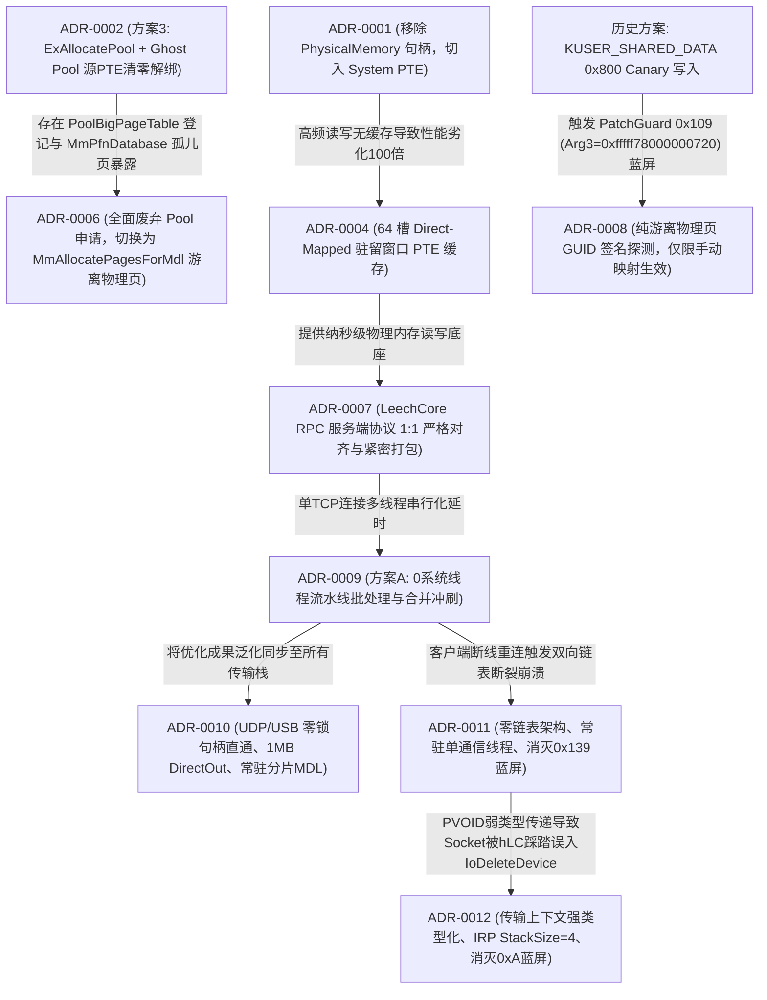

# CheatDrv 架构决策记录索引 (Architecture Decision Records)

本文档是 `CheatDrv` 项目所有关键架构决策、通信协议规范、系统级负向知识与避坑铁律的全局总索引。
**【AI 助手与研发团队铁律】**：在进行任何内核方案设计、协议重构、以及排查内核崩溃（BSOD/BugCheck）之前，**必须首先查阅本索引表与对应 ADR 正文**，严禁引入已被废弃的历史方案，严禁违反已知约束。

---

## 一、 架构决策速查总表

| ADR 编号 | 决策标题 | 核心领域 | 状态 | 核心技术要点 | 关键避坑与负向知识 |
| :--- | :--- | :--- | :--- | :--- | :--- |
| [**ADR-0001**](0001-iat-clean-and-hal-removal.md) | 驱动 IAT 导入表极致净化与 HAL 依赖彻底剥离 | 内核安全 / 静态免杀 | **已采纳** | 剥离 `HAL.dll`（CPU 自旋替代 `KeStallExecutionProcessor`）；内存分配与 IRP 全量动态化重定向；CR8 读取 IRQL | 严禁在驱动源码全局 `#define` 系统导出（如 `ObfDereferenceObject`），防止污染 WDK 头文件；IAT 仅保留 `__C_specific_handler` |
| [**ADR-0002**](0002-pte-remap-stealth-and-ace-mitigation.md) | PTE Remap 驱动高隐匿性架构改造与反作弊(ACE)规避规范 | 内存挂接 / 隐蔽注入 | **部分被替代** | JIT 动态翻转 `NX` 标志（微秒级执行窗口）；本地单核 TLB 刷新；纯叶子平栈中继；`PsInvertedFunctionTable` 启发式接管 | 严禁改 `CR0.WP` 强写（触碰 HVCI）；严禁侵入 `.rsrc` 节；严禁寄生于 `tcpip.sys`；*(注：第 6 条 Ghost Pool 解绑方案已被 ADR-0006 替代)* |
| [**ADR-0003**](0003-wechat-memory-parser-precision-model.md) | 微信 64 位内存数据解析模型重构与结构对齐 | 应用层逆向 / 内存解析 | **已采纳** | 64 位 `std::string` 手机号锚点对齐模型；群聊 `@chatroom` 强类型校验；589 联系人全量双流聚合；高清头像 URL 后向提取 | `std::string` 容量 > 15 为堆指针模式；MSVC CRT `fopen_s` 严禁混用 `"ccs=UTF-8"` 与字节流 `fprintf`（会引发 `0xC0000417` 闪退），需用 `"wb"` + 手动 BOM |
| [**ADR-0004**](0004-pte-cache-and-cr3-hierarchical-caching.md) | 轻量级 System PTE 驻留窗口缓存与 CR3 页表分级缓存架构 | 内核内存读写 / 性能优化 | **已采纳** | 1024 槽黄金平衡 System PTE 驻留窗口 + 斐波那契散列；Sequence Lock 读读无锁直读；阶梯式退避消灭 50ms 争用；RPC 原位直读零拷贝消除池锁争用 | 读写属性严格分离（读操作强制置位最高位 NX，RW=0，写操作 RW=1）；驱动清理时必须原子复原 1024 槽原始 PTE 并释放映射空间；严禁在快/慢路径高频打印 DBG |
| [**ADR-0005**](0005-transport-layer-performance-and-reliability-overhaul.md) | 传输层通信架构重构与性能可靠性加固 (TCP / UDP / USB) | 跨环/跨机网络通信 | **已采纳** | TCP 常驻 IRP 循环重用 (`IoReuseIrp`) 与滑动窗口游标；UDP 1400 字节 MTU 友好型分片重组；USB 流水线非阻塞轮询 | 严禁对常驻 IRP 重入调用；重用必须重置栈指针并重新挂接完成例程；线程退出前必须确保 IRP 处于非挂起态 |
| [**ADR-0006**](0006-headless-mdl-pages-and-pool-removal.md) | 全面废弃 ExAllocatePool 机制与纯游离物理页(MDL)架构决策 | 内存分配 / 反作弊对抗 | **已采纳** | 彻底废除 `ExAllocatePoolWithTag`；引入 `MmAllocatePagesForMdl` 纯游离物理页；宿主原生常驻物理页原位复用；`ScopedThreadAffinity` 绑核 | 严禁使用大池内存（`PoolBigPageTable` 必有记录）；严禁强行清零源 PTE 制造 `MmPfnDatabase` 孤儿页；严禁物理写 `_MMPFN` 结构（会触发 PatchGuard `0x109` 蓝屏） |
| [**ADR-0007**](0007-leechcore-rpc-protocol-1to1-alignment.md) | LeechCore RPC 服务端协议一比一对齐与防错位规范 | 跨环/跨机网络通信 / 协议规范 | **已采纳** | `WriteScatter` 响应严格采用 `cMEMs * sizeof(BOOL)` 布尔数组；`ReadScatter` 实施两阶段紧密打包仅打包成功页（杜绝 Offset Shift）；集成 4 槽 XPRESS 并发压缩与自动解压管道；继承 64 槽 System PTE 读写底座 | 严禁在 WriteScatter 返回全量 `MEM_SCATTER` 结构体；严禁在 ReadScatter 响应中保留失败页空洞数据；严禁硬编码工作区体积（必须动态查询）；严禁解包超过 64MB 防止溢出 |
| [**ADR-0009**](0009-wsk-nng-async-worker-pool-and-multiplexing.md) | WSK NNG 流水线批处理与全双工异步双缓冲发送架构 (Pipeline Batching & Double-Buffered Async Send) | 跨环/跨机网络通信 / 并发优化 | **已采纳** | 彻底废除多工作线程池；纯单线程流水线批处理（0 额外系统线程，100% 免疫反作弊）；4 槽位 1MB 全双工深度环形流水线；100~240 页大跨页 100% DirectOut 原位直写；分发前智能预估与前置异步冲刷（消灭 100% 大池分配与二次 memcpy）；`WSK_FLAG_NODELAY` 即时出网 | 严禁在热路径频繁调用 `ExAllocatePoolWithTag` 导致内核池自旋锁争用；严禁在热路径使用 KeWaitForSingleObject 微秒超时轮询（受限于系统时钟节拍导致 2ms 延迟雪崩）；严禁异步 IRP 完成例程使用局部栈变量上下文（会引发 BugCheck `0xD1`）；WSK 关闭必须原子置空指针防范二次 Close |
| [**ADR-0010**](0010-transport-layer-unified-optimization-udp-usb.md) | 全传输层高性能优化同步与统一直通架构 (UDP & USB Transport Layer Optimization) | 跨环/跨机网络通信 / 传输层统一 | **已采纳** | 统一抽象 `MK_TRANSPORT_CONTEXT` 通用直通上下文；UDP/USB 零锁句柄直通消灭互斥体争用；UDP 扩容至 1MB 支持 100% DirectOut 原位直写；UDP 常驻 `pSliceBuf` + 预构建 MDL 彻底消灭分片热路径动态分配；USB 全双工双缓冲重叠 I/O 流水线 (`UsbHub_BulkWriteAsync` + `UsbHub_BulkReadFast`，常驻 IRP / MDL 0 动态申请，消灭 250 微秒单管停等气泡) | 严禁在传输服务端停止时遗留旧句柄缓存（必须显式置空）；UDP 切片必须遵循 `MK_UDP_SLICE_HDR` 契约；严禁引入额外内核线程 |
| [**ADR-0011**](0011-zero-list-permanent-thread-and-corrupt-entry-bsod.md) | 零链表架构、常驻单线程模型与彻底根除 BugCheck 0x139 (FAST_FAIL_CORRUPT_LIST_ENTRY) | 网络通信架构 / 系统崩溃根治 | **已采纳** | 彻底废除 `LIST_ENTRY` 双向链表与多客户端并发模型；驱动全生命周期仅创建单个常驻系统线程（`WskServerThread`）；单例 5.2MB 上下文一次性预分配与持久化复用；串行 Accept 阻塞唤醒 | 严禁在网络断线重连等动态生命周期中使用裸 `LIST_ENTRY`（内核 `int 29h` 完整性校验极易引发 `0x139` 蓝屏）；严禁在客户端接入时动态调用 `PsCreateSystemThread` 触发反作弊深度审计；大尺寸缓冲严禁高频申请释放 |
| [**ADR-0012**](0012-wsk-transport-context-corruption-and-stack-underflow-bsod-0xa.md) | 传输层通用直通上下文强类型化与彻底根除 BugCheck 0xA (IRQL_NOT_LESS_OR_EQUAL) | 跨环网络通信 / 系统崩溃根治 / 类型安全防御 | **已采纳** | `PMK_TRANSPORT_CONTEXT` 强类型化废除 `PVOID` 传递；`MK_WSK_CLIENT` 嵌入 `TransportCtx` 彻底隔离 `Socket` 偏移；IRP `StackSize` 统一由 1 升至 4 防止下层过滤驱动栈下溢；内核规范高半区指针校验 | 严禁使用弱类型 `PVOID` 传递包含可写成员的跨层上下文（导致结构体偏移错位踩踏对象首字段）；IRP 栈大小严禁写死 1；套接字派遣前必须强校验规范指针地址 |

---

## 二、 架构演进路线与替代关系

---

## 三、 系统级核心负向知识速查 (Negative Knowledge)

在驱动与加载器开发中，以下为经全量推演与踩坑总结的**绝对禁忌操作**：

1. **蓝屏 BugCheck `0x109` (CRITICAL_STRUCTURE_CORRUPTION)**：
   - 严禁试图物理修改 `nt!MmPfnDatabase` 中的 `_MMPFN` 结构体来伪造页表归属；PatchGuard 会周期性做 DPC 校验。
   - **严禁向 `KUSER_SHARED_DATA`（`0xFFFFF78000000000`）写入任何数据**：现代 Windows 10/11 的 PatchGuard 会对整页 `_KUSER_SHARED_DATA` 进行加密哈希校验；在 `0x800` 等空闲偏移写入会导致运行约 20 分钟后触发 `0x109` 蓝屏（Arg3=0xfffff78000000720），必须采用 ADR-0008 游离物理页方案。
2. **蓝屏 BugCheck `0x1E` / `0x4E` (PFN_LIST_CORRUPT) / `0xBE` (ATTEMPTED_WRITE_TO_READONLY_MEMORY)**：
   - 现代 Windows 10/11 开启 HVCI 场景下，严禁通过修改 `CR0.WP` 强写只读内存；
   - 写入内核页前必须通过物理页表设置 `PTE.RW = 1`，并在写入后及时还原。
3. **蓝屏 BugCheck `0xFC` (ATTEMPTED_EXECUTE_OF_NOEXECUTE_MEMORY)**：
   - 代码执行落点所在的 PTE 必须物理清除最高位 `PTE.NX`（置 0）；
   - 挂接探针前必须使用 `ScopedThreadAffinity` 锁定单核，防止核间调度导致多核 TLB 视图不同步。
4. **蓝屏 BugCheck `0xD1` (DRIVER_IRQL_NOT_LESS_OR_EQUAL)**：
   - 严禁将函数的局部栈变量用作异步 IRP 完成例程的上下文参数（`IoSetCompletionRoutine` 中的 `Context`）；
5. **蓝屏 BugCheck `0x50` (PAGE_FAULT_IN_NONPAGED_AREA - Write to Read-Only Page)**：
   - **严禁在内核 Shellcode 中依赖硬编码栈偏移（如 `mov rcx, [rsp + 0xC0]`）企图自完成 IRP (Self-Complete IRP)**：
     * Windows x64 ABI 中，IRP 指针在寄存器 `rdx` 中传递；宿主白驱动或不同的编译器优化下，绝不会保证将 `rdx` 稳定溢出存入栈帧特定偏移槽位；
     * 脆弱的栈偏移常会读取到调用方（如 `nt!IofCallDriver+0x55`）留在栈上的返回地址。此时若盲写 `mov dword ptr [rcx+30h], 0`，等同于尝试修改 `ntoskrnl.exe` 只读代码段，立即引发硬件 MMU 保护违例（BugCheck `0x50`，Arg2=`0x03`）；
     * **正确防范与规避准则**：探针 Shellcode（`scAllocMdlProbe`）与加载 Shellcode（`scDirectExec`）必须严格遵循**跳回宿主现场（`hookReturnVA = site.kernVA + 5`）**，恢复所有寄存器并将执行结果状态码放入 `ebx`，由宿主原有的 WHQL 认证派遣流程自然提交并完成 IRP，严禁由外部 Shellcode 强行猜测宿主私有栈帧。
6. **蓝屏 BugCheck `0x3B` (SYSTEM_SERVICE_EXCEPTION - 0xC0000005 NULL Pointer Dereference)**：
   - **宿主白驱动（如 `Machenike.sys`）default 分支漏恢复设备扩展指针 `rdi` 陷阱**：
     * 宿主派遣函数的 IRP 完成清理例程通常依赖寄存器（如 `rdi`）持有 `DeviceExtension`，并通过 `[rdi + 0x40]` 调用宿主缓存的 `IofCompleteRequest` 函数指针；
     * 宿主白驱动在常规分支跳入 cleanup 前均有 `mov rdi, [rsp + 0x38]` 重载操作，但在未支持的未知 IOCTL `switch default` 分支处往往缺少此重载，导致 `rdi = 0` 进入清理流程时触发 `mov r8, [rdi+40h]` 空指针访问违例；
     * **防御修复准则**：在 Shellcode 跳回宿主 `site.kernVA + 5` 前，必须显式替宿主执行 `mov rdi, [rsp + 0x38]`（宿主栈上备份的 `DeviceExtension`，而 `[rsp + 0x50]` 在入口处被清零），保证宿主后续间接调用 `IofCompleteRequest` 时指针有效合法。
   - **内核 Shellcode 践踏 x64 非易失性寄存器（`rbp` / `ebp`）导致外层文件锁崩溃陷阱**：
     * x64 ABI 明确规定 `rbp` 属于非易失性寄存器（Callee-saved）；Windows 内热 I/O 管理器（`nt!IopSynchronousServiceTail`）在进入驱动派遣前，使用 `rbp` 寄存器长期持有 `FileObject` 指针；
     * Shellcode 严禁随手借用 `ebp` 作为临时状态码变量；一旦清零或覆写 `ebp`，驱动返回内核后 `IopReleaseFileObjectLock(FileObject)` 将获取到 `rcx = 0`，解引用 `[rbx + 0x74]` 必然引发崩溃；
   - **内核态清理栈上伪造对象时越界清零（Stack Smashing）导致寄存器全零与 IRP 崩溃陷阱**：
     * 手动映射执行 Shellcode（`scDirectExec`）通常在局部栈帧上伪造临时 `DRIVER_OBJECT`（`0x150` 字节）；核心驱动初始化完毕后若调用 `RtlZeroMemory(pDriverObj, 0x200)`，超出 `0x150` 字节边界的清零动作会直接向高地址栈帧越界践踏 136 字节；
     * 越界清零会直接将 Shellcode 压栈保护的 7 个非易失性寄存器（`r15..r12, rdi, rsi, rbx`）以及宿主白驱动栈上局部变量（`[rsp + 0x38]` 等）全量置零。Shellcode 平栈弹出后所有寄存器归零，跳回宿主执行 `mov [r15+30h], ebx` 时立即触发 `r15 = 0` 空指针崩溃（BugCheck `0x3B`，Arg2=`Machenike+0x17fc`）；
     * **防御修复准则**：对象擦除必须严格限制在 `sizeof(DRIVER_OBJECT)`（`0x150` 字节），严禁使用超出边界的硬编码尺寸（如 `0x200`）；同时 Shellcode 栈帧必须分配充足安全冗余（`sub rsp, 0x248`）形成纵深防御。
7. **蓝屏 BugCheck `0x1E` (KMODE_EXCEPTION_NOT_HANDLED - 0xC0000005 #GP) / x64 ABI 栈对齐与 SSE `movaps` 崩溃**：
   - **内核 Shellcode 调用 `DriverEntry` 违反 x64 ABI 16 字节栈对齐要求**：
     * Windows x64 ABI 明确规定：函数在发起 `CALL` 指令前，栈指针 `%rsp` 必须满足 16 字节对齐（`RSP % 16 == 0`）。进入被调用函数的第一条指令时，由于压入了 8 字节的返回地址，`RSP` 必然为 `0x...8`（`RSP % 16 == 8`）；
     * 宿主白驱动在 Hook 点处处于函数内部计算状态，其 `rsp_host` 严格以 16 字节对齐（`% 16 == 0`）；
     * `scDirectExec` 压入 7 个寄存器（56 字节，`56 % 16 == 8`），若紧接着使用 `sub rsp, 0x240`（576 字节，`576 % 16 == 0`），则总栈消耗为 632 字节（`632 % 16 == 8`）。此时在执行 `call rax`（调用 `DriverEntry`）前 `RSP % 16 == 8`，`call` 压栈后进入 `DriverEntry` 入口时 `RSP % 16 == 0`；
     * 这导致后续执行体所有函数的局部栈偏移全部错位 8 字节。当调用系统内部涉及 SSE 指令的内核例程（如 `nt!RtlpHpSegMgrCommit`、`nt!ExAllocatePoolWithTag` 中的 `movaps xmmword ptr [rbp-31h], xmm0`）时，目标内存地址以 8 结尾未对齐 16 字节，直接触发 CPU 硬件通用保护错误 `#GP`（BugCheck `0x1E`，参数1=`0xC0000005`，参数2=`nt!RtlpHpSegMgrCommit+0x14a`）；
     * **防御修复准则**：在保留 7 个压栈寄存器（56 字节）的前提下，局部栈帧分配量必须满足 `(56 + STACK_ALLOC) % 16 == 0`，即必须将 `sub/add rsp, 0x240` 调整为 **`sub/add rsp, 0x248`**（584 字节，`56 + 584 = 640 = 0x280`，严格为 16 的倍数），保证在 `call DriverEntry` 瞬间 `RSP % 16 == 0`，进入函数后 `RSP % 16 == 8`，彻底杜绝 SSE 指令 `#GP` 异常。
8. **反作弊检出靶点 (ACE / EAC / Vanguard)**：
   - **大池表**：任何大于 4KB 的 `ExAllocatePool*` 必然登记在 `nt!PoolBigPageTable` 中，不可作为隐蔽代码载体；
   - **系统线程创建**：严禁在内核态直接调用 `PsCreateSystemThread` 创建匿名工作线程池，会触发反作弊 `PsSetCreateThreadNotifyRoutine` 深度审计 StartAddress 归属；多线程并发吞吐必须通过 ADR-0009 流水线批处理与合并冲刷解决；
   - **PE 头篡改**：严禁篡改宿主白驱动的 DOS/NT 头部与 `.pdata` 异常表；必须采用 Leaf 纯叶子平栈退出；
   - **资源节**：严禁借用 `.rsrc` 节区（白驱动资源目录被文件完整性哈希严格校验）。
9. **蓝屏 BugCheck `0x139` (KERNEL_SECURITY_CHECK_FAILURE - Arg1=0x3 FAST_FAIL_CORRUPT_LIST_ENTRY)**：
   - **双向链表在断线重连竞态下的断裂与硬件断言崩溃**：
     * Windows 8 及以上内核中，执行 `InsertTailList` 或 `RemoveEntryList` 时内核内置硬件级完整性自检 `int 29h`（`FAST_FAIL_CORRUPT_LIST_ENTRY`）；
     * 在高频断线重连或多核调度场景下，若采用多线程各自在 worker 线程退出时解绑链表，极易因并发时序产生旧节点 `Blink->Flink != ListHead` 的悬挂自环断裂，瞬间引发系统不可拦截的 `0x139` 蓝屏；
     * **防御修复准则 (Zero-List 铁律)**：在以单一控制端为主的内核通道中，坚决废除 `LIST_ENTRY`、`ClientListLock` 与多客户端管理模型；切换为**单例预分配（5.2MB 一次性预分配）与常驻单系统线程（`WskServerThread` 串行 Accept/Session）架构**，从数据结构与数学层面上物理消灭 `BugCheck 0x139` 的所有触发路径。
10. **蓝屏 BugCheck `0xA` (IRQL_NOT_LESS_OR_EQUAL - Arg1=0x18, Arg2=0x2 DISPATCH_LEVEL)**：
    - **跨层接口 PVOID 弱类型强转导致相邻结构体首字段（Socket）被覆写踩踏**：
      * 严禁在内核模块间使用 `PVOID` 传递带有内部修改特权的通用上下文指针；
      * 若调用方传递父对象（`MK_WSK_CLIENT`），而被调用方无条件强转为子上下文（`MK_TRANSPORT_CONTEXT`）并执行赋值（`pTransCtx->Cached_hLC = hLC`），会直接将首字段 `Socket` 覆写为 `hLC`（`LC_CONTEXT*`）；
      * `WskSend` 读取篡改后的 `Socket->Dispatch`，实际读到了 `LC_CONTEXT` 偏移 0 的 `UserVar`，而 `UserVar` 偏移 `+0x30` 正好是 `IoDeleteDevice`，导致网络分发误入 `IoDeleteDevice`，并在 `DISPATCH_LEVEL` 解引用非法的 `DeviceObjectExtension` 触发不可挽回的 `0xA` 蓝屏；
      * **防御修复准则**：全面推行**强类型声明（`PMK_TRANSPORT_CONTEXT`）**，废除所有 `PVOID` 泛型上下文；嵌套结构体必须使用组合或联合体严格按成员取地址传递；分配 IRP 栈位置必须升级为 `StackSize >= 4`，杜绝任何栈下溢越界。

---

## 四、 维护与新增规范
当触发以下事件之一时，必须在此目录下新建 `XXXX-简要描述.md`，并同步更新本索引表：
1. 核心内核 API 族系增删与替换；
2. 跨环通信协议号、结构体字段或内存对齐变更；
3. 系统级负向知识（蓝屏 BugCheck 解决与死锁踩坑）；
4. 反作弊对抗机制重大重构。
